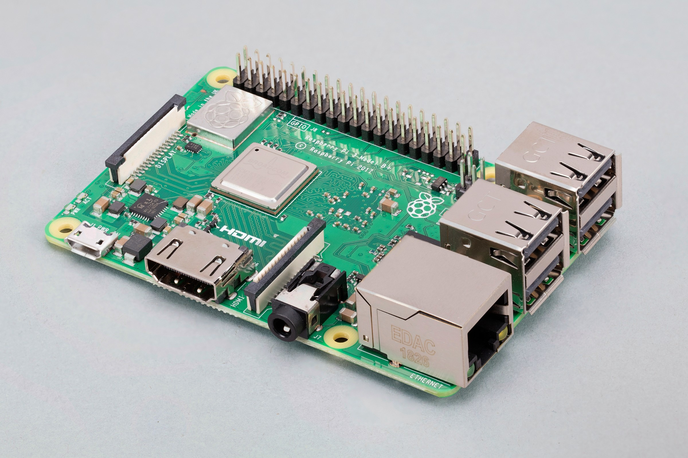
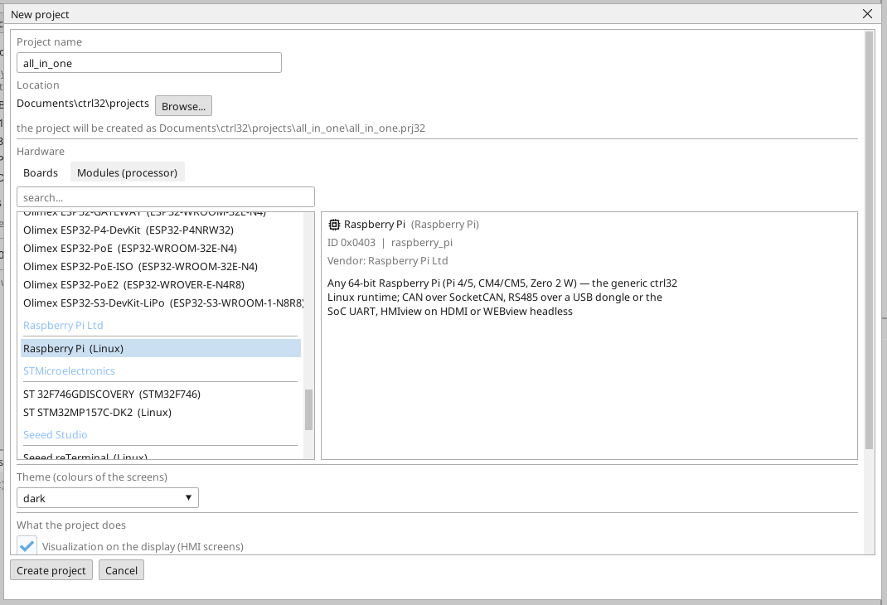

# Встановіть runtime ctrl32

Linux runtime ctrl32 - це програма на платі, яка виконує ваш проєкт: цикл PLC, екран на моніторі, WEBview, OPC UA і шини. Редактор встановлює його через мережу; жодної команди Linux вводити не треба.

## 1. Запишіть карту

Запишіть на карту **Raspberry Pi OS Lite (64-bit)** за допомогою Raspberry
Pi Imager. *Lite* - навмисно: runtime сам малює екран і не потребує
робочого столу. Перед записом задайте в налаштуваннях Imager:

- **ім'я хоста (hostname)**, яке ви впізнаєте в мережі,
- **користувача** та його **пароль**,
- **SSH увімкнено**,
- Wi-Fi - лише якщо Pi не буде підключено кабелем.

Вставте карту в Pi, підключіть Ethernet і монітор та увімкніть його.

## 2. Створіть проєкт

Запустіть редактор ctrl32 і виберіть **New project** (Ctrl+N). Введіть **назву** проєкту, виберіть **Raspberry Pi** у розділі **Linux** і натисніть **Create project**.

Щоб натомість почати з готового прикладу, відкрийте [проєкт all-in-one](examples/all-in-one/README.uk.md) (**File → Open**).

## 3. Підготуйте плату

Виберіть **Online → Prepare a Linux device**. Введіть **адресу** плати, **користувача** та **пароль** з кроку 1 і натисніть **Look at the device**: редактор входить, читає, що це за плата, і перелічує, що він зробить - перегляд нічого не змінює. Потім натисніть **Prepare it**: редактор копіює runtime, встановлює його як службу, запускає й чекає, поки він відповість. Відтоді плата запускає runtime під час кожного завантаження.

Залиште позначку **Do not ask for the password again**: редактор розміщує на платі свій власний ключ, і для наступних підключень потрібна лише адреса. Пароль використовується один раз і ніколи не зберігається.

Під планом розділ **Operating system of this device** містить те, що
належить Pi, а не проєкту: CAN HAT (один рядок на кожен CAN-чип на SPI),
звільнення послідовного порту для RS-485 HAT, I2C, фіксовану адресу та
ядро реального часу для EtherCAT. Позначте те, що є на вашому Pi; кожен
позначений рядок - це один крок, а Pi перезапускається лише тоді, коли
змінилося налаштування завантаження.

## 4. Завантажте проєкт

Введіть адресу плати у вибір порту на панелі інструментів і натисніть кнопку завантаження (F5). Runtime завантажує проєкт, і екран з'являється на моніторі.

## 5. Перевірте, що все працює

- **ONLINE** (значок штекера) показує живі значення в ланцюгах, змінних і на екрані.
- **WEBview**: `http://<адреса>:8080` у браузері в тій самій мережі.
- **OPC UA**: `opc.tcp://<адреса>:4840` - кожна змінна є вузлом, `ns=1;s=<ім'я>`.

| Порт | Що там працює |
|---|---|
| 8080 | WEBview, завантаження програми, пошук пристрою |
| 4840 | сервер OPC UA |
| 3232 | онлайн-з'єднання редактора |

Щось не працює? Див. [Усунення несправностей](troubleshooting.uk.md).

*Знімки екрана: редактор ctrl32 1.07.*

---

[← Обладнання та підключення](hardware.uk.md) | [Огляд](README.uk.md) | [Налаштування →](configure.uk.md)
