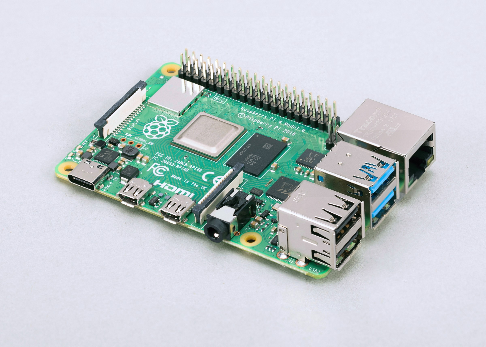
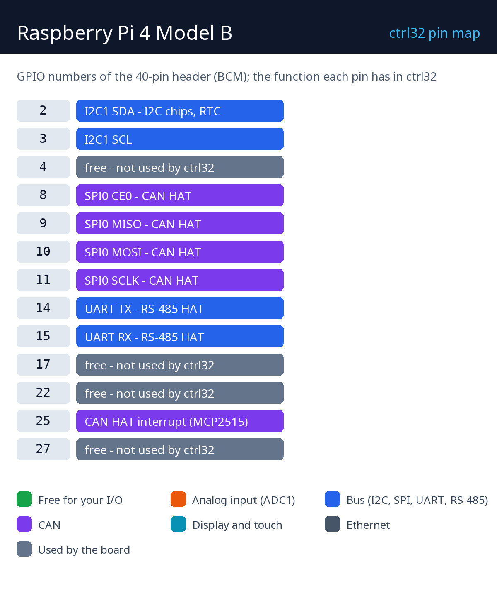

# Raspberry Pi 4 Model B

    

Raspberry Pi 4 Model B uruchamia runtime ctrl32 dla Linuksa - największy cel ctrl32: dziesiątki tysięcy zmiennych, HMI na monitorze HDMI, serwer OPC UA dla systemu SCADA, napędy EtherCAT, CAN i RS-485 przez nakładki HAT lub adaptery USB oraz przetwarzanie obrazu z kamerą. Edytor instaluje runtime przez sieć; Pi uruchamia go potem przy każdym starcie.

**Nadaje się do:**

- Sterownik linii z HMI na monitorze HDMI i OPC UA do systemu SCADA
- Master EtherCAT dla serwonapędów
- Bramka między Modbus, CAN, OPC UA i MQTT

Strona płytki w katalogu: [Raspberry Pi 4 Model B](https://ctrl32.com/hardware/boards/raspberry-pi-4-model-b/)

## Co ctrl32 potrafi na tej płytce

<!-- capabilities:start -->
| Funkcja | Na tej płytce | Uwagi |
|---|---|---|
| Układ | Linux |  |
| Rozmiar programu | 20480 zmiennych, 4096 alarmów, 40960 bloków | edytor sprawdza to przed wgraniem |
| Wejścia / wyjścia cyfrowe | przez moduły I/O | Modbus, CANopen, EtherCAT |
| Ethernet | tak |  |
| Wi-Fi | Wi-Fi 5 (2.4 + 5 GHz) |  |
| CAN | przez CAN HAT lub adapter USB | SocketCAN, do 4 magistral |
| Modbus RTU (RS-485) | tak | adapter USB lub HAT |
| Modbus TCP | klient i serwer |  |
| MQTT | tak (także TLS) | wykrywanie w Home Assistant |
| WEBview | tak | strona operatora w każdej przeglądarce |
| Serwer OPC UA | tak |  |
| EtherCAT master | tak | na drugim porcie Ethernet |
| Wyświetlacz (HMI) | HDMI lub panel DSI | lub bez wyświetlacza z WEBview |
| USB | USB-C |  |
| Zasilanie | 5 V USB |  |
<!-- capabilities:end -->

### Czego nie obsługujemy

- 40-pinowe złącze GPIO jako wejścia i wyjścia programu - wejścia i wyjścia idą przez moduły I/O (Modbus RTU / TCP, CANopen, EtherCAT); złącze przenosi magistrale nakładek HAT.
- Bluetooth.
- Środowisko graficzne - runtime sam rysuje ekran; system, którego oczekuje, to Raspberry Pi OS Lite.

## Poradnik

| Krok | Strona |
|---|---|
| 1 | [Sprzęt i okablowanie](hardware.pl.md) - czego potrzebujesz, zasilanie, mapa pinów |
| 2 | [Instalacja runtime](install.pl.md) - edytor, płytka, pierwsze wgranie |
| 3 | [Konfiguracja](configure.pl.md) - sieć, I/O, komunikacja |
| 4 | [Przykładowe projekty](examples/README.pl.md) - wszystko, co płytka potrafi, gotowe do otwarcia |
| - | [Rozwiązywanie problemów](troubleshooting.pl.md) |

## Pliki

-

## Dalsze kroki

- [Dokumentacja ctrl32](https://ctrl32.com/docs/) - edytor, języki, każdy blok
- [Pobierz edytor](https://ctrl32.com/download/)
- [Wszystkie przetestowane płytki](../../README.pl.md)
- [Raspberry Pi 5](../raspberry-pi-5/README.pl.md)
- Raspberry Pi 3 Model B+
- [Runtime dla Linuksa](https://ctrl32.com/docs/linux-runtime/) - co robi i jakie ma limity

