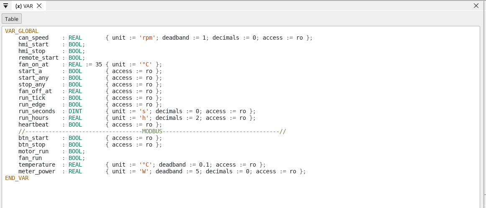
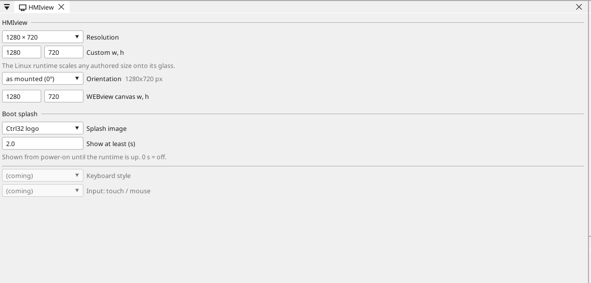

# Configurer la carte

## La page de la carte

Double-cliquez sur la carte dans l'arbre des appareils. La page montre ce que porte la carte et chaque broche : une broche libre reçoit une variable en un clic - une entrée, une sortie, ou sur une broche analogique une entrée analogique.

## Réseau

Le Pi conserve les réglages réseau de son système d'exploitation : DHCP du
routeur, sauf si **Prepare a Linux device** a défini une adresse fixe.
Trouvez-le par son nom d'hôte ou avec **Find devices** dans l'éditeur.

## Entrées, sorties et variables

Chaque signal du programme est une **variable**. Une variable sur une broche lit ou pilote la broche ; une variable analogique indique ce qui y est raccordé (une tension, 4-20 mA, une thermistance) et sa plage en unités.

## Communication

**Modbus TCP.** Un appareil du réseau s'ajoute sous **Ethernet → Modbus TCP master** ; ses registres deviennent des variables.

**Modbus RTU / RS-485.** Un adaptateur USB-RS485 (`/dev/ttyUSB0`, la direction commute d'elle-même) ou un HAT RS-485 sur l'UART du Pi. ctrl32 y est maître ou esclave Modbus RTU, sur jusqu'à quatre lignes.

**CAN.** Le CAN vient d'un HAT CAN sur SPI (MCP2515, MCP251xFD) ou d'un adaptateur CAN USB ; le runtime l'utilise comme interface SocketCAN (`can0`, jusqu'à quatre bus). Prepare a Linux device ajoute le pilote du HAT ; le débit est celui du projet.

**MQTT.** La carte publie des variables choisies vers un broker ; en mode Home Assistant, le broker les trouve de lui-même, et une variable marquée *write* peut être réglée depuis là.

## Écran

Le runtime dessine sur le moniteur HDMI branché (ou un écran DSI) et y
adapte le projet ; l'exemple est dessiné en 1280 x 720. Le tactile USB
d'un moniteur tactile fonctionne sans pilote. Sans moniteur, le Pi ne sert
ses écrans qu'aux navigateurs (WEBview).

## OPC UA, EtherCAT et vision

- **OPC UA** - chaque variable du projet est un nœud du serveur propre au
  Pi (`opc.tcp://<adresse>:4840`, `ns=1;s=<nom>`) ; une variable peut en
  être exclue d'une coche dans la liste des variables. Rien d'autre n'est
  à régler.
- **EtherCAT** - un maître sur un port Ethernet dédié, pour des
  servovariateurs et des bornes d'E/S ; le noyau temps réel de Prepare a
  Linux device maintient le cycle de bus sous la milliseconde.
- **Vision** - une caméra USB et les blocs de vision (présence, mesure,
  codes, un réseau de neurones) - voir
  [Vision](https://ctrl32.com/docs/vision/).

## WEBview

La carte sert sa page opérateur à tout navigateur du réseau - ouvrez l'adresse de la carte. La page se dessine dans l'éditeur comme un écran.

---

[← Installer le runtime](install.fr.md) | [Vue d'ensemble](README.fr.md) | [Projets d'exemple →](examples/README.fr.md)
