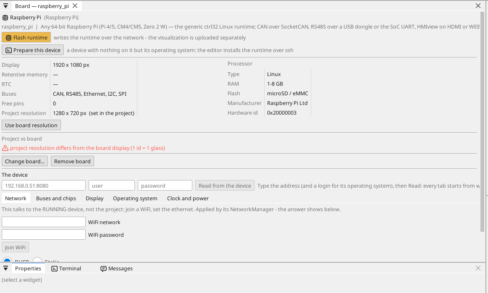
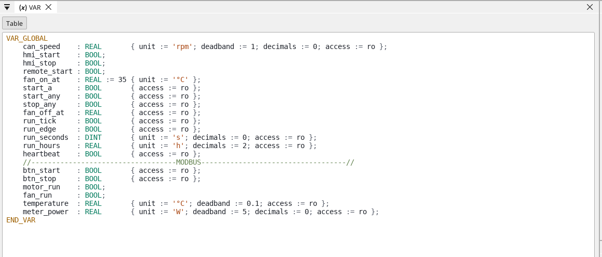
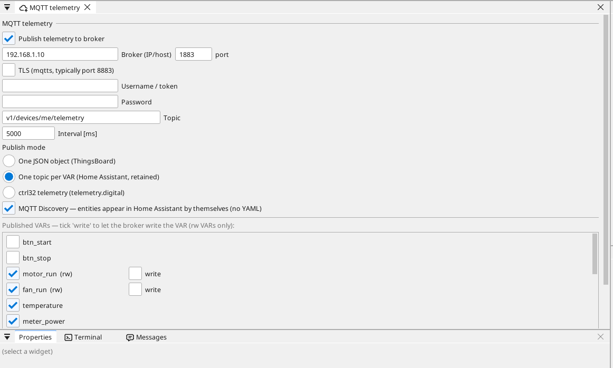
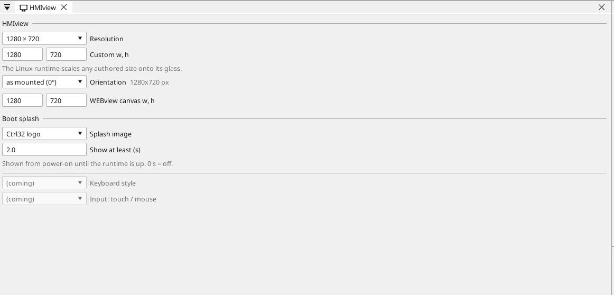
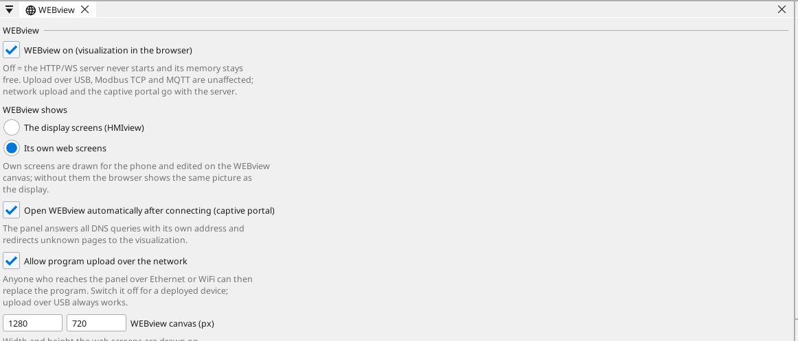

# Configure the board

## The board page

Double-click the board in the device tree. The page shows what the board carries and every pin: a free pin gets a variable in one click - an input, an output, or on an analog-capable pin an analog input.

## Network

The Pi keeps the network settings of its operating system: DHCP from the
router unless **Prepare a Linux device** set a fixed address. Find it by
its hostname or with the editor's **Find devices**.

## Inputs, outputs and variables

Every signal of the program is a **variable**. A variable on a pin reads or drives the pin; an analog variable says what is wired to it (a voltage, 4-20 mA, a thermistor) and its range in units.

## Communication

**Modbus TCP.** A device on the network is added under **Ethernet → Modbus TCP master**; its registers become variables.

**Modbus RTU / RS-485.** A USB-RS485 adapter (`/dev/ttyUSB0`, the direction switches by itself) or an RS-485 HAT on the Pi's UART. ctrl32 is a Modbus RTU master or slave on it, up to four lines.

**CAN.** CAN comes from a CAN HAT on SPI (MCP2515, MCP251xFD) or a USB CAN adapter; the runtime uses it as a SocketCAN interface (`can0`, up to four buses). Prepare a Linux device adds the HAT's driver; the bit rate is the project's.

**MQTT.** The board publishes chosen variables to a broker; in the Home Assistant mode the broker finds them by itself, and a variable marked *write* can be set from there.

## Display

The runtime draws on the connected HDMI monitor (or a DSI display) and
scales the project to it; the example is drawn at 1280 x 720. A touch
monitor's USB touch works without a driver. Without a monitor the Pi
serves its screens to browsers only (WEBview).

## OPC UA, EtherCAT and vision

- **OPC UA** - every variable of the project is a node of the Pi's own
  server (`opc.tcp://<address>:4840`, `ns=1;s=<name>`); a variable can be
  kept off it with one tick in the variable list. Nothing else is set.
- **EtherCAT** - a master on an Ethernet port of its own, for servo
  drives and I/O terminals; the real-time kernel from Prepare a Linux
  device keeps the bus cycle under a millisecond.
- **Vision** - a USB camera and the vision blocks (presence, measuring,
  codes, a neural network) - see [Vision](https://ctrl32.com/docs/vision/).

## WEBview

The board serves its operator page to any browser on the network - open the board's address. The page is drawn in the editor like a screen.

---

[← Install the runtime](install.md) | [Overview](README.md) | [Example projects →](examples/README.md)
