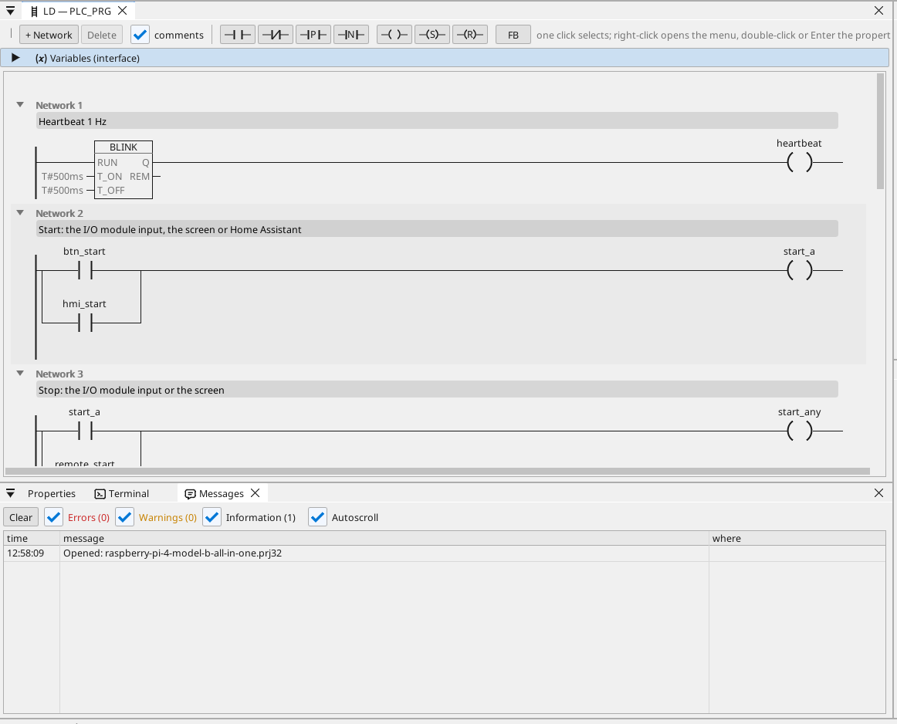

# All-in-one

Motor a ventilátor na I/O modulu Modbus RTU, ovládané z obrazovky HDMI, z WEBview a z Home Assistantu, s elektroměrem Modbus TCP, rámci CAN, motohodinami, trendem, alarmy a každou proměnnou na OPC UA.

**Stáhnout:** [all-in-one.prj32](all-in-one.prj32) - otevři ho v editoru ctrl32 (**File → Open**).

## Co dělá

Program je malé řízení stroje na Linux runtime:

- **Vstupy a výstupy** přicházejí z **I/O modulu Modbus RTU** (unit 2)
  na adaptéru USB-RS485: start na vstupu 0, stop na vstupu 1, motor na
  cívce 0 a ventilátor na cívce 1.
- **Start** přijde i z obrazovky a z Home Assistantu přes MQTT; **Stop**
  z obrazovky.
- **Teplota** přichází z čidla **Modbus RTU** na stejné lince (unit 1);
  ventilátor ji sleduje s hysterezí.
- **Motohodiny** počítají každou sekundu chodu a přežijí výpadek
  napájení.
- Elektroměr **Modbus TCP** dává odebíraný výkon; **CAN** (HAT, `can0`)
  posílá stav motoru a ventilátoru v rámci 0x181 a přijímá rychlost
  v rámci 0x281.
- Obrazovka běží na monitoru **HDMI**; jednodušší stránka v libovolném
  prohlížeči (**WEBview**); každá proměnná je na serveru **OPC UA**.

## Program

## Stránka operátora

## Otevři a spusť

1. Otevři `all-in-one.prj32` v editoru.
2. Změň adresy (zařízení Modbus, broker MQTT) na adresy své sítě.
3. Spusť **simulaci** (panel nástrojů) a vyzkoušej ho na PC, nebo ho nahraj do desky - viz [Nahrání runtime](../../install.cs.md).

## Co bys měl vidět

Na monitoru se objeví obrazovka. Stiskni **Start**: LED motoru se
rozsvítí a cívka 0 modulu sepne. Trend kreslí teplotu; klient OPC UA
(například SCADA) najde každou proměnnou pod Objects > ctrl32.

---

[← Vzorové projekty](../README.cs.md) | [Přehled](../../README.cs.md)
