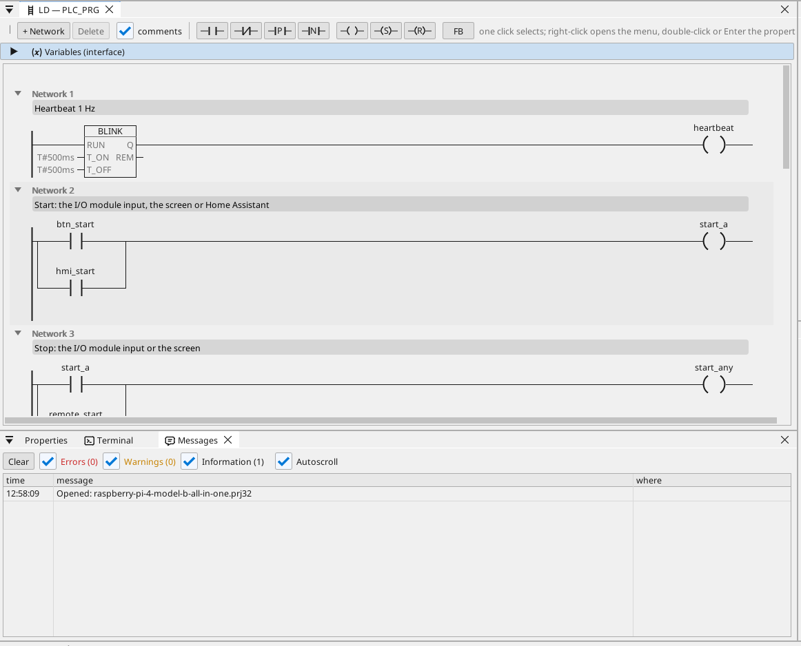

# All-in-one

Un moteur et un ventilateur sur un module d'E/S Modbus RTU, commandés depuis l'écran HDMI, WEBview et Home Assistant, avec un compteur Modbus TCP, des trames CAN, les heures de marche, une courbe, les alarmes et chaque variable sur OPC UA.

**Téléchargement :** [all-in-one.prj32](all-in-one.prj32) - ouvrez-le dans l'éditeur ctrl32 (**File → Open**).

## Ce qu'il fait

Le programme est une petite commande de machine sur le runtime Linux :

- Les **entrées et sorties** viennent d'un **module d'E/S Modbus RTU**
  (unité 2) sur un adaptateur USB-RS485 : marche sur l'entrée 0, arrêt
  sur l'entrée 1, le moteur sur la bobine 0 et le ventilateur sur la
  bobine 1.
- **Start** vient aussi de l'écran et de Home Assistant via MQTT ;
  **Stop** de l'écran.
- La **température** vient d'un capteur **Modbus RTU** sur la même
  ligne (unité 1) ; le ventilateur la suit avec une hystérésis.
- Les **heures de marche** comptent chaque seconde de fonctionnement et
  résistent à une coupure de courant.
- Un compteur **Modbus TCP** donne la puissance appelée ; le **CAN** (un
  HAT, `can0`) envoie l'état du moteur et du ventilateur dans la trame
  0x181 et reçoit une vitesse dans la trame 0x281.
- L'écran tourne sur le moniteur **HDMI** ; une page plus simple dans
  tout navigateur (**WEBview**) ; chaque variable est sur le serveur
  **OPC UA**.

## Le programme

## La page opérateur

## L'ouvrir et l'exécuter

1. Ouvrez `all-in-one.prj32` dans l'éditeur.
2. Remplacez les adresses (l'appareil Modbus, le broker MQTT) par celles de votre réseau.
3. Lancez la **simulation** (barre d'outils) pour l'essayer sur le PC, ou chargez-le dans la carte - voir [Installer le runtime](../../install.fr.md).

## Ce que vous devriez voir

L'écran apparaît sur le moniteur. Appuyez sur **Start** : la LED du
moteur s'allume et la bobine 0 du module commute. La courbe trace la
température ; un client OPC UA (un SCADA par exemple) trouve chaque
variable sous Objects > ctrl32.

---

[← Projets d'exemple](../README.fr.md) | [Vue d'ensemble](../../README.fr.md)
