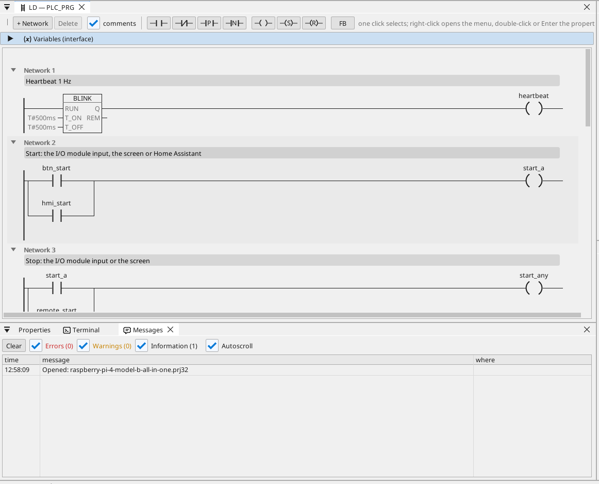

# All-in-one

Un motore e un ventilatore su un modulo I/O Modbus RTU, comandati dallo schermo HDMI, da WEBview e da Home Assistant, con un contatore Modbus TCP, frame CAN, ore di funzionamento, un trend, gli allarmi e ogni variabile su OPC UA.

**Download:** [all-in-one.prj32](all-in-one.prj32) - aprilo nell'editor ctrl32 (**File → Open**).

## Cosa fa

Il programma è un piccolo controllore di macchina sul runtime Linux:

- **Ingressi e uscite** arrivano da un **modulo I/O Modbus RTU**
  (unit 2) su un adattatore USB-RS485: start sull'ingresso 0, stop
  sull'ingresso 1, il motore sulla coil 0 e il ventilatore sulla
  coil 1.
- **Start** arriva anche dalla schermata e da Home Assistant tramite
  MQTT; **Stop** dalla schermata.
- La **temperatura** arriva da un sensore **Modbus RTU** sulla stessa
  linea (unit 1); il ventilatore la segue con isteresi.
- Le **ore di funzionamento** contano ogni secondo di marcia e si
  conservano in caso di mancanza di corrente.
- Un contatore **Modbus TCP** fornisce la potenza assorbita; **CAN**
  (un HAT, `can0`) invia lo stato del motore e del ventilatore nel
  frame 0x181 e riceve una velocità nel frame 0x281.
- La schermata gira sul monitor **HDMI**; una pagina più semplice in
  qualsiasi browser (**WEBview**); ogni variabile è sul server
  **OPC UA**.

## Il programma

## La pagina operatore

## Aprirlo ed eseguirlo

1. Apri `all-in-one.prj32` nell'editor.
2. Cambia gli indirizzi (il dispositivo Modbus, il broker MQTT) con quelli della tua rete.
3. Avvia la **simulazione** (barra degli strumenti) per provarlo sul PC, oppure scaricalo sulla scheda - vedi [Installare il runtime](../../install.it.md).

## Cosa dovresti vedere

La schermata compare sul monitor. Premi **Start**: il LED del motore si
accende e la coil 0 del modulo commuta. Il trend disegna la
temperatura; un client OPC UA (ad esempio uno SCADA) trova ogni
variabile sotto Objects > ctrl32.

---

[← Progetti di esempio](../README.it.md) | [Panoramica](../../README.it.md)
