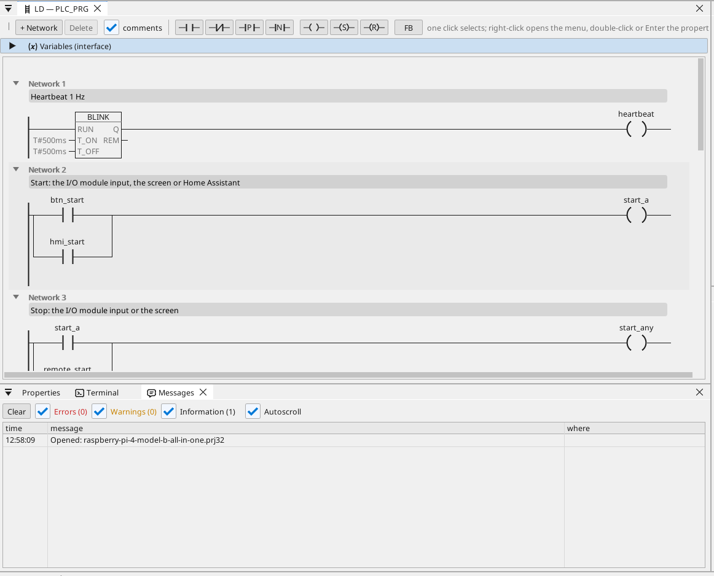
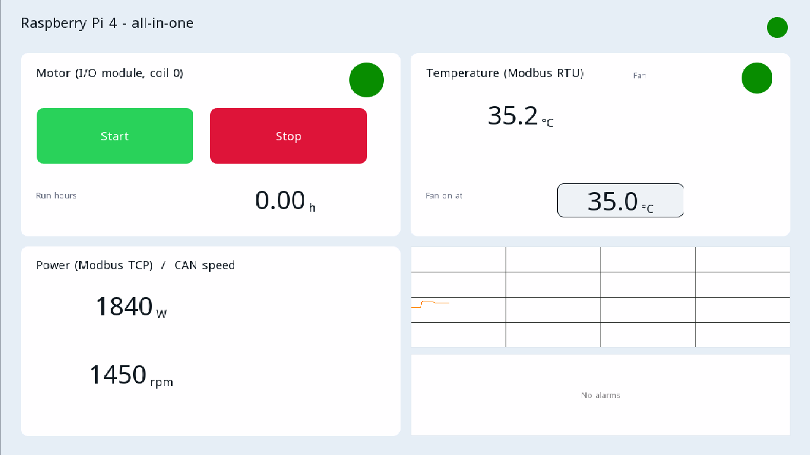

# All-in-one

Silnik i wentylator na module I/O Modbus RTU, sterowane z ekranu HDMI, WEBview i Home Assistant, z licznikiem Modbus TCP, ramkami CAN, licznikiem godzin pracy, wykresem, alarmami i każdą zmienną w OPC UA.

**Pobieranie:** [all-in-one.prj32](all-in-one.prj32) - otwórz go w edytorze ctrl32 (**File → Open**).

## Co robi

Program to mały sterownik maszyny w runtime dla Linuksa:

- **Wejścia i wyjścia** pochodzą z **modułu I/O Modbus RTU** (unit 2)
  na adapterze USB-RS485: start na wejściu 0, stop na wejściu 1,
  silnik na cewce 0, a wentylator na cewce 1.
- **Start** pochodzi także z ekranu i z Home Assistant przez MQTT;
  **Stop** z ekranu.
- **Temperatura** pochodzi z czujnika **Modbus RTU** na tej samej
  linii (unit 1); wentylator podąża za nią z histerezą.
- **Godziny pracy** liczą każdą sekundę pracy i są zachowywane po
  zaniku zasilania.
- Licznik **Modbus TCP** podaje pobór mocy; **CAN** (nakładka HAT,
  `can0`) wysyła stan silnika i wentylatora w ramce 0x181 i odbiera
  prędkość w ramce 0x281.
- Ekran działa na monitorze **HDMI**; prostsza strona w każdej
  przeglądarce (**WEBview**); każda zmienna jest na serwerze
  **OPC UA**.

## Program

## Strona operatora

## Otwórz i uruchom

1. Otwórz `all-in-one.prj32` w edytorze.
2. Zmień adresy (urządzenia Modbus, brokera MQTT) na adresy swojej sieci.
3. Uruchom **symulację** (pasek narzędzi), aby wypróbować projekt na PC, albo wgraj go na płytkę - zobacz [Instalacja runtime](../../install.pl.md).

## Co powinieneś zobaczyć

Na monitorze pojawia się ekran. Naciśnij **Start**: dioda silnika
świeci, a cewka 0 modułu się przełącza. Wykres rysuje temperaturę;
klient OPC UA (na przykład SCADA) znajduje każdą zmienną w Objects >
ctrl32.

---

[← Przykładowe projekty](../README.pl.md) | [Przegląd](../../README.pl.md)
