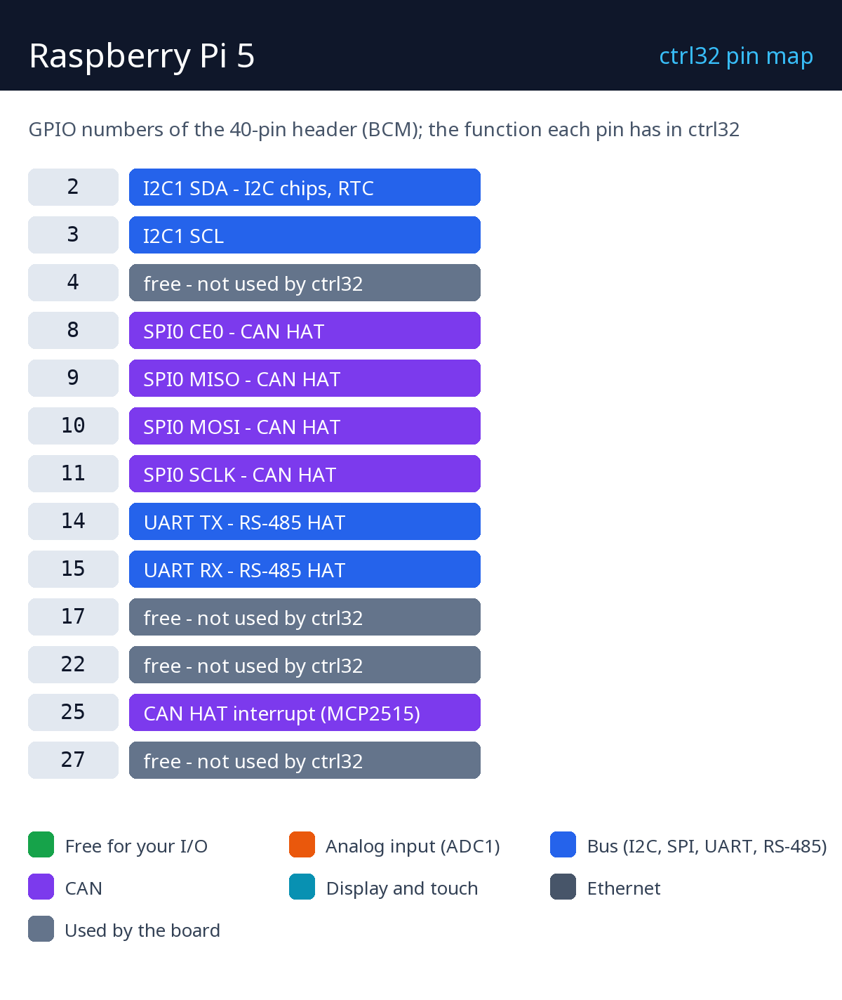

# Raspberry Pi 5

    

Il Raspberry Pi 5 esegue il runtime Linux di ctrl32 - il target più grande di ctrl32: decine di migliaia di variabili, un HMI sul monitor HDMI, un server OPC UA per lo SCADA, azionamenti EtherCAT, CAN e RS-485 tramite HAT o adattatori USB, e visione artificiale con una fotocamera. L'editor installa il runtime tramite la rete; il Pi lo avvia poi a ogni boot.

**Adatta a:**

- Un controllore di linea con un HMI su un monitor HDMI e OPC UA verso lo SCADA
- Un master EtherCAT per servoazionamenti
- Un gateway tra Modbus, CAN, OPC UA e MQTT

Pagina della scheda nel catalogo: [Raspberry Pi 5](https://ctrl32.com/hardware/boards/raspberry-pi-5/)

## Cosa sa fare ctrl32 su questa scheda

<!-- capabilities:start -->
| Funzione | Su questa scheda | Note |
|---|---|---|
| Chip | Linux |  |
| Dimensione del programma | 20480 variabili, 4096 allarmi, 40960 blocchi | l'editor lo verifica prima del download |
| Ingressi / uscite digitali | tramite moduli I/O | Modbus, CANopen, EtherCAT |
| Ethernet | sì |  |
| Wi-Fi | Wi-Fi 5 (2.4 + 5 GHz) |  |
| CAN | tramite un CAN HAT o un adattatore USB | SocketCAN, fino a 4 bus |
| Modbus RTU (RS-485) | sì | un adattatore USB o un HAT |
| Modbus TCP | client e server |  |
| MQTT | sì (anche TLS) | rilevamento in Home Assistant |
| WEBview | sì | la pagina operatore in qualsiasi browser |
| Server OPC UA | sì |  |
| EtherCAT master | sì | su una seconda porta Ethernet |
| Display (HMI) | HDMI o un pannello DSI | oppure senza display con WEBview |
| USB | USB-C |  |
| Alimentazione | USB-C PD 5 V / 5 A |  |
<!-- capabilities:end -->

### Cosa non è supportato

- Il connettore GPIO a 40 pin come I/O del programma - ingressi e uscite passano tramite moduli I/O (Modbus RTU / TCP, CANopen, EtherCAT); il connettore porta i bus degli HAT.
- Bluetooth.
- Un ambiente desktop - il runtime disegna lo schermo da solo; il sistema che richiede è Raspberry Pi OS Lite.

## La guida

| Passo | Pagina |
|---|---|
| 1 | [Hardware e cablaggio](hardware.it.md) - cosa ti serve, alimentazione, la mappa dei pin |
| 2 | [Installare il runtime](install.it.md) - l'editor, la scheda, il primo caricamento |
| 3 | [Configurare](configure.it.md) - rete, I/O, comunicazione |
| 4 | [Progetti di esempio](examples/README.it.md) - tutto ciò che la scheda sa fare, pronto da aprire |
| - | [Risoluzione dei problemi](troubleshooting.it.md) |

## File

| File | Cosa |
|---|---|
| [pinout/pinout.svg](pinout/pinout.svg) | la mappa dei pin, vettoriale (anche [PNG](pinout/pinout.png)) |
| [raspberry-pi-5-mechanical-drawing.pdf](datasheets/raspberry-pi-5-mechanical-drawing.pdf) | Raspberry Pi 5 mechanical drawing |
| [raspberry-pi-5-rp1-peripherals.pdf](datasheets/raspberry-pi-5-rp1-peripherals.pdf) | RP1 peripherals |
| [raspberry-pi-5-3d.zip](3d/raspberry-pi-5-3d.zip) | Modello 3D (GLB, compresso) |
| [NOTICE](https://github.com/ctrl32/hardware/blob/main/NOTICE.md) | da dove provengono foto, schemi e modelli |

## Passi successivi

- [Documentazione ctrl32](https://ctrl32.com/docs/) - l'editor, i linguaggi, ogni blocco
- [Scarica l'editor](https://ctrl32.com/download/)
- Tutte le schede testate
- Raspberry Pi 4 Model B
- Raspberry Pi 3 Model B+
- [Il runtime Linux](https://ctrl32.com/docs/linux-runtime/) - cosa fa e i suoi limiti

