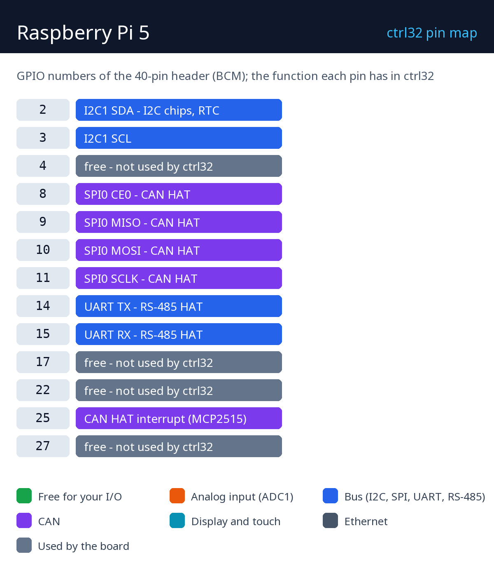

# Raspberry Pi 5

    

The Raspberry Pi 5 runs the ctrl32 Linux runtime - the largest ctrl32 target: tens of thousands of variables, an HMI on the HDMI monitor, an OPC UA server for SCADA, EtherCAT drives, CAN and RS-485 through HATs or USB adapters, and machine vision with a camera. The editor installs the runtime over the network; the Pi then starts it at every boot.

**Good for:**

- A line controller with an HMI on an HDMI monitor and OPC UA to SCADA
- An EtherCAT master for servo drives
- A gateway between Modbus, CAN, OPC UA and MQTT

Board page in the catalog: [Raspberry Pi 5](https://ctrl32.com/hardware/boards/raspberry-pi-5/)

## What ctrl32 can do on this board

<!-- capabilities:start -->
| Feature | On this board | Notes |
|---|---|---|
| Chip | Linux |  |
| Program size | 20480 variables, 4096 alarms, 40960 blocks | checked by the editor before a download |
| Digital inputs / outputs | through I/O modules | Modbus, CANopen, EtherCAT |
| Ethernet | yes |  |
| Wi-Fi | Wi-Fi 5 (2.4 + 5 GHz) |  |
| CAN | through a CAN HAT or a USB adapter | SocketCAN, up to 4 buses |
| Modbus RTU (RS-485) | yes | a USB dongle or a HAT |
| Modbus TCP | client and server |  |
| MQTT | yes (TLS too) | Home Assistant discovery |
| WEBview | yes | the operator page in any browser |
| OPC UA server | yes |  |
| EtherCAT master | yes | on a second Ethernet port |
| Display (HMI) | HDMI or a DSI panel | or headless with WEBview |
| USB | USB-C |  |
| Power | USB-C PD 5 V / 5 A |  |
<!-- capabilities:end -->

### What is not supported

- The 40-pin GPIO header as I/O of the program - inputs and outputs go through I/O modules (Modbus RTU / TCP, CANopen, EtherCAT); the header carries the buses of HATs.
- Bluetooth.
- A desktop environment - the runtime draws the screen itself; Raspberry Pi OS Lite is the system it wants.

## The guide

| Step | Page |
|---|---|
| 1 | [Hardware and wiring](hardware.md) - what you need, power, the pin map |
| 2 | [Install the runtime](install.md) - the editor, the board, the first upload |
| 3 | [Configure](configure.md) - network, I/O, communication |
| 4 | [Example projects](examples/README.md) - everything the board does, ready to open |
| - | [Troubleshooting](troubleshooting.md) |

## Files

| File | What |
|---|---|
| [pinout/pinout.svg](pinout/pinout.svg) | the pin map, vector (also [PNG](pinout/pinout.png)) |
| [raspberry-pi-5-mechanical-drawing.pdf](datasheets/raspberry-pi-5-mechanical-drawing.pdf) | Raspberry Pi 5 mechanical drawing |
| [raspberry-pi-5-rp1-peripherals.pdf](datasheets/raspberry-pi-5-rp1-peripherals.pdf) | RP1 peripherals |
| [raspberry-pi-5-3d.zip](3d/raspberry-pi-5-3d.zip) | 3D model (GLB, zipped) |
| [NOTICE](https://github.com/ctrl32/hardware/blob/main/NOTICE.md) | where the photos, schematics and models come from |

## Next steps

- [ctrl32 documentation](https://ctrl32.com/docs/) - the editor, the languages, every block
- [Download the editor](https://ctrl32.com/download/)
- [All tested boards](../../README.md)
- [Raspberry Pi 4 Model B](../raspberry-pi-4-model-b/README.md)
- [Raspberry Pi 3 Model B+](../raspberry-pi-3-model-b/README.md)
- [The Linux runtime](https://ctrl32.com/docs/linux-runtime/) - what it does and its limits

