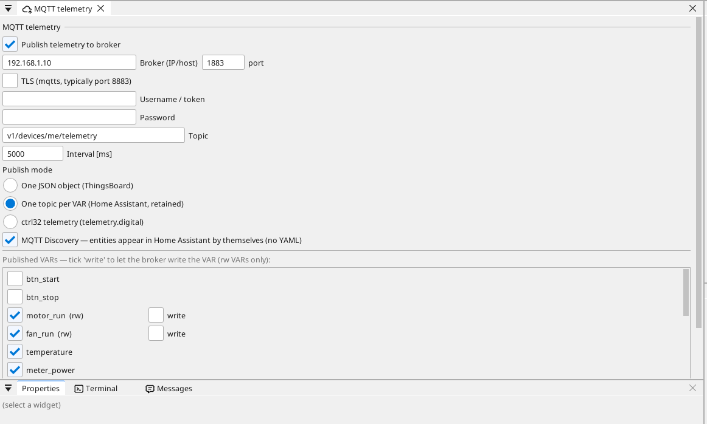

# Konfiguracja płytki

## Strona płytki

Kliknij dwukrotnie płytkę w drzewie urządzeń. Strona pokazuje, co płytka ma na pokładzie, i każdy pin: wolny pin dostaje zmienną jednym kliknięciem - wejście, wyjście albo, na pinie analogowym, wejście analogowe.

## Sieć

Pi zachowuje ustawienia sieci swojego systemu operacyjnego: DHCP z
routera, chyba że **Prepare a Linux device** ustawił stały adres.
Znajdziesz go po nazwie hosta lub przez **Find devices** w edytorze.

## Wejścia, wyjścia i zmienne

Każdy sygnał programu jest **zmienną**. Zmienna na pinie odczytuje lub steruje pinem; zmienna analogowa mówi, co jest do niej podłączone (napięcie, 4-20 mA, termistor), oraz jej zakres w jednostkach.

## Komunikacja

**Modbus TCP.** Urządzenie w sieci dodaje się w **Ethernet → Modbus TCP master**; jego rejestry stają się zmiennymi.

**Modbus RTU / RS-485.** Adapter USB-RS485 (`/dev/ttyUSB0`, kierunek przełącza się sam) lub nakładka RS-485 HAT na UART Pi. ctrl32 jest na nim masterem lub slave'em Modbus RTU, do czterech linii.

**CAN.** CAN pochodzi z nakładki CAN HAT na SPI (MCP2515, MCP251xFD) lub z adaptera USB CAN; runtime używa go jako interfejsu SocketCAN (`can0`, do czterech magistral). Prepare a Linux device dodaje sterownik nakładki; prędkość transmisji jest ustawiana w projekcie.

**MQTT.** Płytka publikuje wybrane zmienne do brokera; w trybie Home Assistant broker sam je znajduje, a zmienną oznaczoną *write* można stamtąd ustawić.

## Wyświetlacz

Runtime rysuje na podłączonym monitorze HDMI (lub wyświetlaczu DSI) i
skaluje do niego projekt; przykład jest narysowany w 1280 x 720. Dotyk
USB monitora dotykowego działa bez sterownika. Bez monitora Pi
udostępnia swoje ekrany tylko przeglądarkom (WEBview).

## OPC UA, EtherCAT i przetwarzanie obrazu

- **OPC UA** - każda zmienna projektu jest węzłem własnego serwera Pi
  (`opc.tcp://<adres>:4840`, `ns=1;s=<nazwa>`); zmienną można z niego
  wyłączyć jednym zaznaczeniem na liście zmiennych. Nic więcej się nie
  ustawia.
- **EtherCAT** - master na własnym porcie Ethernet, dla serwonapędów i
  terminali I/O; jądro czasu rzeczywistego z Prepare a Linux device
  utrzymuje cykl magistrali poniżej milisekundy.
- **Przetwarzanie obrazu** - kamera USB i bloki vision (obecność, pomiar,
  kody, sieć neuronowa) - zobacz [Vision](https://ctrl32.com/docs/vision/).

## WEBview

Płytka udostępnia swoją stronę operatora każdej przeglądarce w sieci - otwórz adres płytki. Stronę rysuje się w edytorze jak ekran.

---

[← Instalacja runtime](install.pl.md) | [Przegląd](README.pl.md) | [Przykładowe projekty →](examples/README.pl.md)
