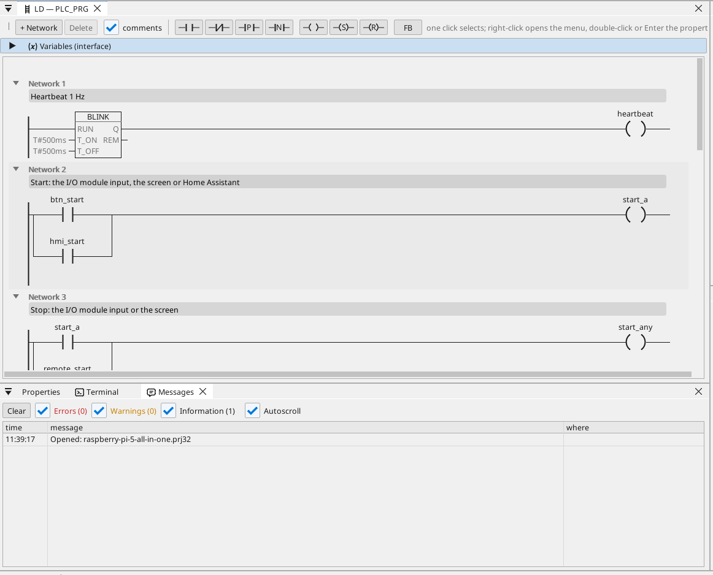

# All-in-one

Egy motor és egy ventilátor egy Modbus RTU I/O modulon, a HDMI képernyőről, a WEBview-ból és Home Assistantból vezérelve, egy Modbus TCP mérővel, CAN keretekkel, üzemórákkal, egy trenddel, a riasztásokkal és minden változóval az OPC UA-n.

**Letöltés:** [all-in-one.prj32](all-in-one.prj32) - nyisd meg a ctrl32 szerkesztőben (**File → Open**).

## Mit csinál

A program egy kis gépvezérlés a Linux runtime-on:

- A **bemenetek és kimenetek** egy **Modbus RTU I/O modulról** jönnek
  (unit 2) egy USB-RS485 adapteren: start a 0-s bemeneten, stop az
  1-es bemeneten, a motor a 0-s coilon, a ventilátor az 1-es coilon.
- A **Start** a képernyőről és Home Assistantból MQTT-n keresztül is
  jöhet; a **Stop** a képernyőről.
- A **hőmérséklet** egy **Modbus RTU** érzékelőtől jön ugyanazon a
  vonalon (unit 1); a ventilátor hiszterézissel követi.
- Az **üzemórák** a működés minden másodpercét számolják, és
  áramszünet után is megmaradnak.
- Egy **Modbus TCP** mérő adja a teljesítményigényt; a **CAN** (egy
  HAT, `can0`) a 0x181 keretben küldi a motor és a ventilátor
  állapotát, és a 0x281 keretben fogad egy fordulatszámot.
- A képernyő a **HDMI** monitoron fut; egy egyszerűbb oldal bármely
  böngészőben (**WEBview**); minden változó az **OPC UA** szerveren
  van.

## A program

## A kezelőoldal

## Megnyitás és futtatás

1. Nyisd meg a `all-in-one.prj32` fájlt a szerkesztőben.
2. Írd át a címeket (a Modbus eszközét, az MQTT brókerét) a saját hálózatodéira.
3. Indítsd el a **szimulációt** (eszköztár), hogy kipróbáld a PC-n, vagy töltsd le a panelre - lásd [A runtime telepítése](../../install.hu.md).

## Amit látnod kell

A képernyő megjelenik a monitoron. Nyomd meg a **Start** gombot: a
motor LED-je világít, és a modul 0-s coilja kapcsol. A trend rajzolja a
hőmérsékletet; egy OPC UA kliens (például egy SCADA) minden változót
megtalál az Objects > ctrl32 alatt.

---

[← Példaprojektek](../README.hu.md) | [Áttekintés](../../README.hu.md)
