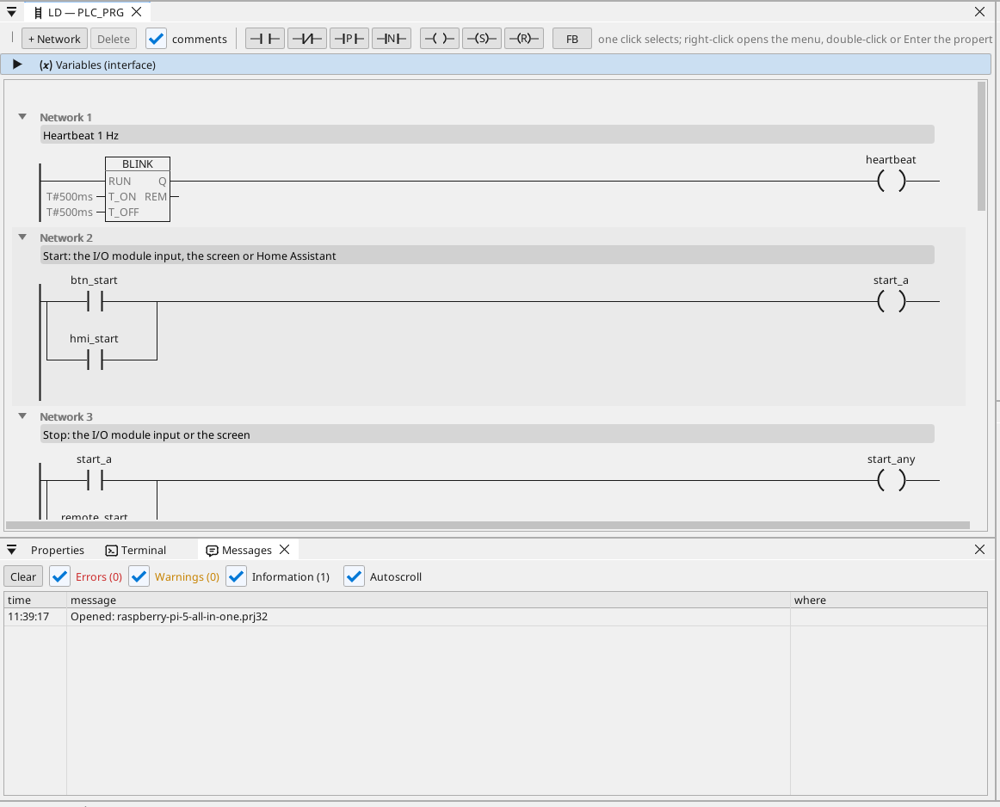
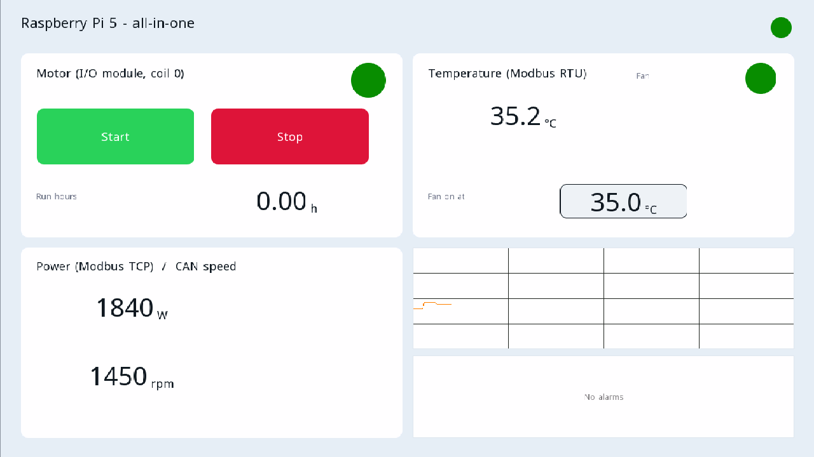

# All-in-one

A motor and a fan on a Modbus RTU I/O module, controlled from the HDMI screen, WEBview and Home Assistant, with a Modbus TCP meter, CAN frames, run hours, a trend, the alarms and every variable on OPC UA.

**Download:** [all-in-one.prj32](all-in-one.prj32) - open it in the ctrl32 editor (**File → Open**).

## What it does

The program is a small machine controller on the Linux runtime:

- **Inputs and outputs** come from a **Modbus RTU I/O module** (unit 2)
  on a USB-RS485 adapter: start on input 0, stop on input 1, the motor
  on coil 0 and the fan on coil 1.
- **Start** also comes from the screen and from Home Assistant over
  MQTT; **Stop** from the screen.
- The **temperature** comes from a **Modbus RTU** sensor on the same
  line (unit 1); the fan follows it with hysteresis.
- The **run hours** count every second of running and survive a power
  cut.
- A **Modbus TCP** meter gives the power demand; **CAN** (a HAT, `can0`)
  sends the motor and fan state in frame 0x181 and receives a speed
  in frame 0x281.
- The screen runs on the **HDMI** monitor; a simpler page in any
  browser (**WEBview**); every variable is on the **OPC UA** server.

## The program

## The operator page

## Open and run it

1. Open `all-in-one.prj32` in the editor.
2. Change the addresses (the Modbus device, the MQTT broker) to the ones of your network.
3. Run the **simulation** (toolbar) to try it on the PC, or download it to the board - see [Install the runtime](../../install.md).

## What you should see

The screen comes up on the monitor. Press **Start**: the motor LED
lights and the module's coil 0 switches. The trend draws the
temperature; an OPC UA client (UaExpert, a SCADA) finds every variable
under Objects > ctrl32.

---

[← Example projects](../README.md) | [Overview](../../README.md)
