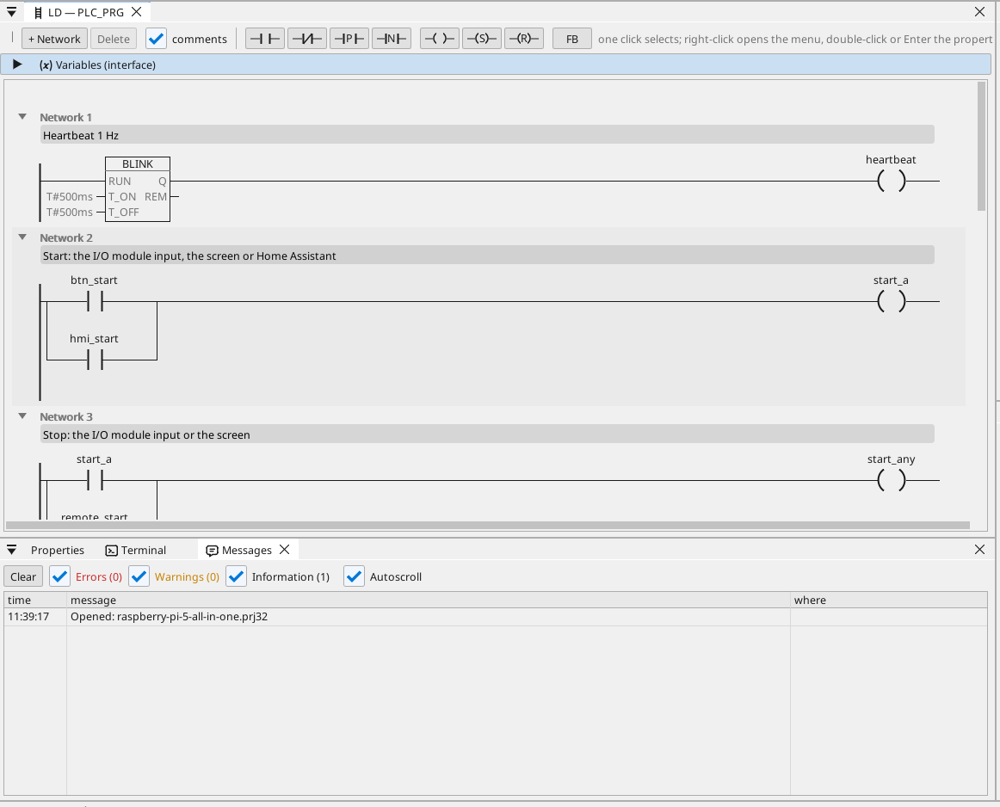
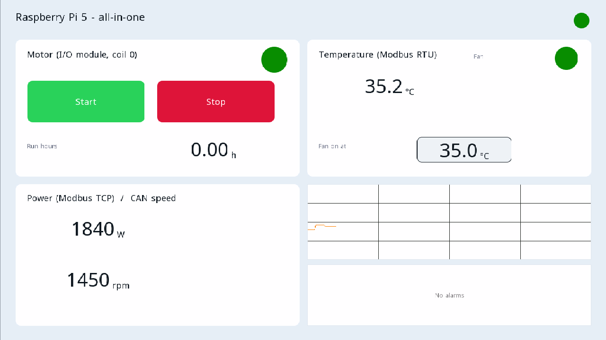

# All-in-one

Motor a ventilátor na I/O module Modbus RTU, ovládané z obrazovky HDMI, z WEBview a z Home Assistant, s elektromerom Modbus TCP, rámcami CAN, motohodinami, priebehom, alarmami a každou premennou na OPC UA.

**Stiahnuť:** [all-in-one.prj32](all-in-one.prj32) - otvor ho v editore ctrl32 (**File → Open**).

## Čo robí

Program je malé riadenie stroja na Linux runtime:

- **Vstupy a výstupy** prichádzajú z **I/O modulu Modbus RTU** (unit 2)
  na adaptéri USB-RS485: štart na vstupe 0, stop na vstupe 1, motor na
  cievke 0 a ventilátor na cievke 1.
- **Štart** príde aj z obrazovky a z Home Assistant cez MQTT; **Stop**
  z obrazovky.
- **Teplota** prichádza zo senzora **Modbus RTU** na tej istej linke
  (unit 1); ventilátor ju sleduje s hysteréziou.
- **Motohodiny** počítajú každú sekundu chodu a prežijú výpadok
  napájania.
- Elektromer **Modbus TCP** dáva odoberaný výkon; **CAN** (HAT, `can0`)
  posiela stav motora a ventilátora v rámci 0x181 a prijíma rýchlosť v
  rámci 0x281.
- Obrazovka beží na monitore **HDMI**; jednoduchšia stránka v
  ľubovoľnom prehliadači (**WEBview**); každá premenná je na serveri
  **OPC UA**.

## Program

## Stránka operátora

## Otvor a spusti

1. Otvor `all-in-one.prj32` v editore.
2. Zmeň adresy (zariadenie Modbus, broker MQTT) na adresy svojej siete.
3. Spusti **simuláciu** (panel nástrojov) a vyskúšaj ho na PC, alebo ho nahraj do dosky - pozri [Nahratie runtime](../../install.sk.md).

## Čo by si mal vidieť

Na monitore sa objaví obrazovka. Stlač **Start**: LED motora sa
rozsvieti a cievka 0 modulu zopne. Priebeh kreslí teplotu; klient OPC
UA (napríklad SCADA) nájde každú premennú pod Objects > ctrl32.

---

[← Vzorové projekty](../README.sk.md) | [Prehľad](../../README.sk.md)
