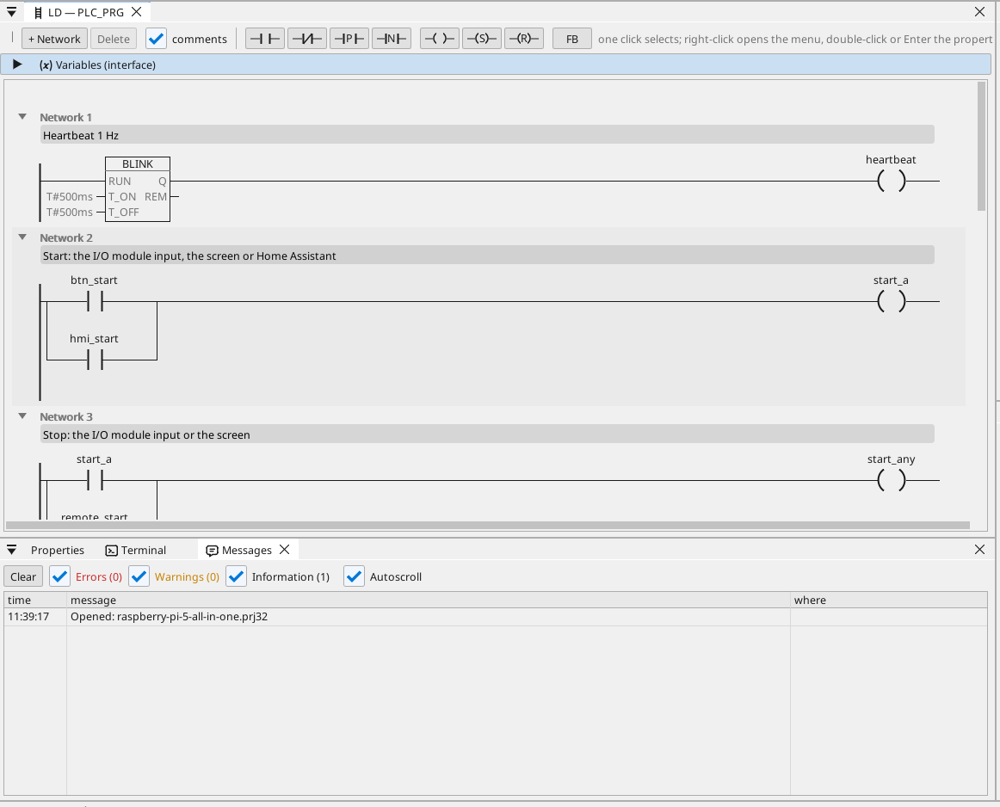

# All-in-one

Bir Modbus RTU G/Ç modülündeki bir motor ve bir fan; HDMI ekrandan, WEBview'dan ve Home Assistant'tan kontrol edilir; bir Modbus TCP sayacı, CAN çerçeveleri, çalışma saatleri, bir trend, alarmlar ve OPC UA'da her değişkenle.

**İndir:** [all-in-one.prj32](all-in-one.prj32) - ctrl32 editöründe açın (**File → Open**).

## Ne yapar

Program, Linux runtime üzerinde küçük bir makine kontrolcüsüdür:

- **Girişler ve çıkışlar**, bir USB-RS485 adaptöründeki bir **Modbus
  RTU G/Ç modülünden** (unit 2) gelir: start giriş 0'da, stop giriş
  1'de, motor coil 0'da ve fan coil 1'de.
- **Start** ayrıca ekrandan ve MQTT üzerinden Home Assistant'tan gelir;
  **Stop** ekrandan.
- **Sıcaklık** aynı hattaki bir **Modbus RTU** sensöründen gelir
  (unit 1); fan onu histerezisle izler.
- **Çalışma saatleri** çalışmanın her saniyesini sayar ve elektrik
  kesintisinde korunur.
- Bir **Modbus TCP** sayacı güç talebini verir; **CAN** (bir HAT,
  `can0`) motorun ve fanın durumunu 0x181 çerçevesinde gönderir ve
  0x281 çerçevesinde bir hız alır.
- Ekran **HDMI** monitörde çalışır; her tarayıcıda daha basit bir sayfa
  (**WEBview**); her değişken **OPC UA** sunucusundadır.

## Program

## Operatör sayfası

## Açın ve çalıştırın

1. `all-in-one.prj32` dosyasını editörde açın.
2. Adresleri (Modbus cihazı, MQTT broker'ı) kendi ağınızınkilerle değiştirin.
3. PC'de denemek için **simülasyonu** (araç çubuğu) çalıştırın ya da karta yükleyin - bkz. [Runtime'ı kurun](../../install.tr.md).

## Ne görmelisiniz

Ekran monitörde açılır. **Start**'a basın: motor LED'i yanar ve
modülün coil 0'ı anahtarlanır. Trend sıcaklığı çizer; bir OPC UA
istemcisi (örneğin bir SCADA) her değişkeni Objects > ctrl32 altında
bulur.

---

[← Örnek projeler](../README.tr.md) | [Genel bakış](../../README.tr.md)
