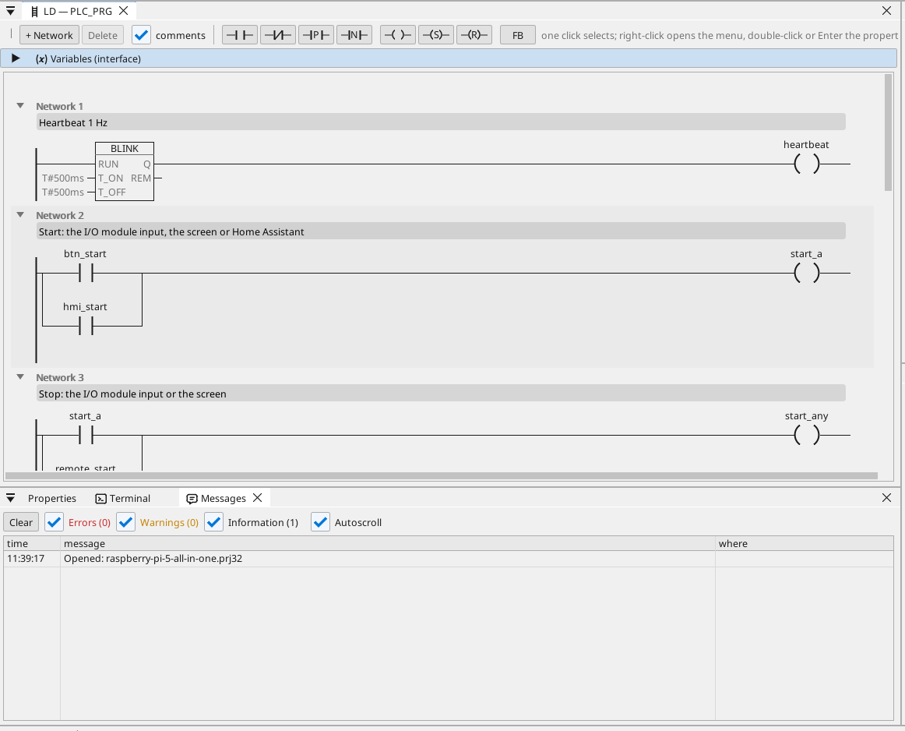

# All-in-one

Двигун і вентилятор на модулі вводу/виводу Modbus RTU, якими керують з HDMI-екрана, WEBview і Home Assistant, з лічильником Modbus TCP, кадрами CAN, мотогодинами, трендом, аварійними сигналами та кожною змінною в OPC UA.

**Завантажити:** [all-in-one.prj32](all-in-one.prj32) - відкрийте його в редакторі ctrl32 (**File → Open**).

## Що він робить

Програма - це невеликий контролер обладнання на Linux runtime:

- **Входи та виходи** надходять від **модуля вводу/виводу Modbus RTU**
  (unit 2) на адаптері USB-RS485: пуск на вході 0, стоп на вході 1,
  двигун на coil 0 і вентилятор на coil 1.
- **Start** також надходить з екрана та з Home Assistant через MQTT;
  **Stop** - з екрана.
- **Температура** надходить від датчика **Modbus RTU** на тій самій
  лінії (unit 1); вентилятор слідує за нею з гістерезисом.
- **Мотогодини** рахують кожну секунду роботи й зберігаються після
  вимкнення живлення.
- Лічильник **Modbus TCP** дає споживану потужність; **CAN** (HAT,
  `can0`) надсилає стан двигуна й вентилятора в кадрі 0x181 і отримує
  швидкість у кадрі 0x281.
- Екран працює на **HDMI**-моніторі; простіша сторінка в будь-якому
  браузері (**WEBview**); кожна змінна є на сервері **OPC UA**.

## Програма

## Сторінка оператора

## Відкрийте й запустіть

1. Відкрийте `all-in-one.prj32` у редакторі.
2. Змініть адреси (пристрій Modbus, брокер MQTT) на адреси вашої мережі.
3. Запустіть **симуляцію** (панель інструментів), щоб спробувати на ПК, або завантажте в плату - див. [Встановлення runtime](../../install.uk.md).

## Що ви маєте побачити

Екран з'являється на моніторі. Натисніть **Start**: світлодіод двигуна
засвічується, і coil 0 модуля перемикається. Тренд малює температуру;
клієнт OPC UA (наприклад, SCADA) знаходить кожну змінну в Objects >
ctrl32.

---

[← Приклади проєктів](../README.uk.md) | [Огляд](../../README.uk.md)
