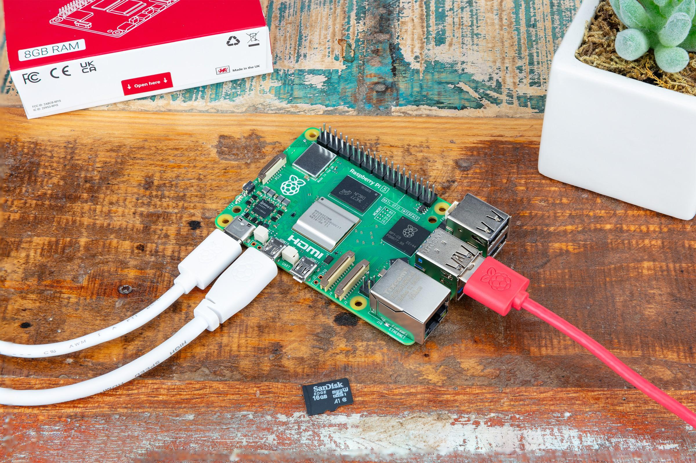
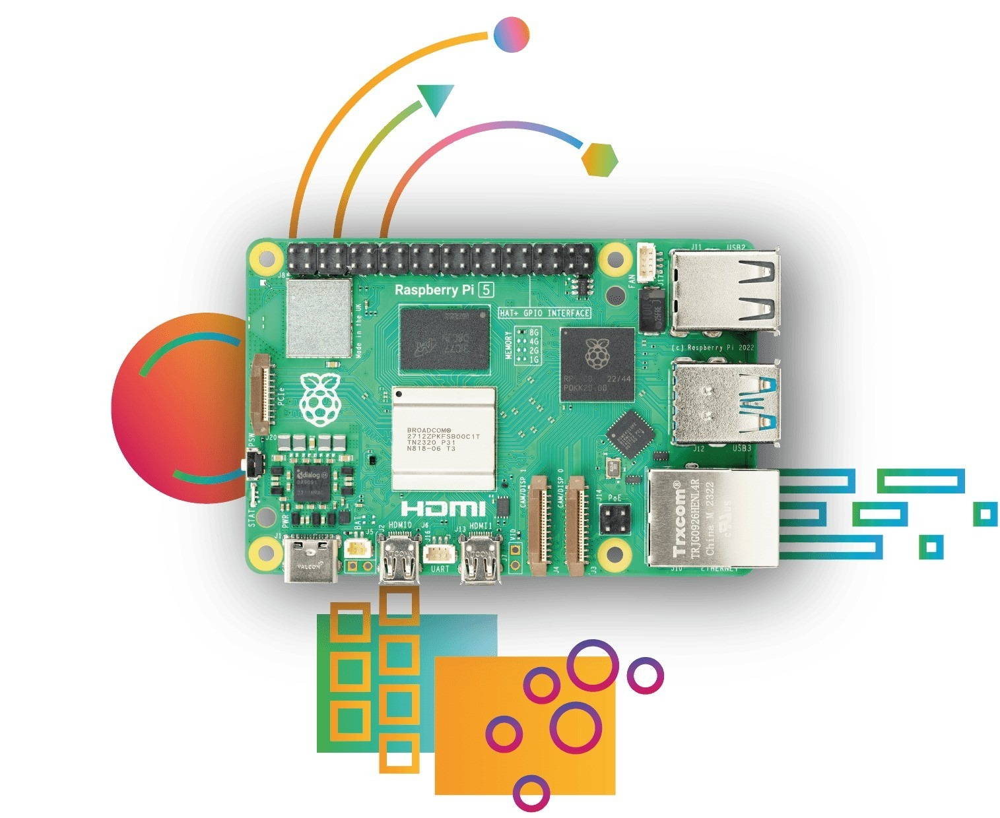

# Hardware y cableado

## Qué necesitas

- Una Raspberry Pi 5 (cualquier tamaño de memoria) con disipador.
- Una tarjeta microSD (16 GB o más) y el [Raspberry Pi Imager](https://www.raspberrypi.com/software/).
- La fuente de alimentación USB-C oficial de 27 W (5 V / 5 A).
- Un cable Ethernet en la misma red que el PC.
- Para el HMI: un monitor HDMI (cable micro-HDMI) o una pantalla DSI; con un monitor táctil, también su USB.
- Un PC con el [editor ctrl32](https://ctrl32.com/download/) (Windows).
- Opcional, para el ejemplo all-in-one: un adaptador USB-RS485 con un módulo de E/S Modbus RTU y un sensor de temperatura; un HAT CAN (MCP2515 o MCP251xFD).

## Alimentación

| Fuente | Dónde | Nota |
|---|---|---|
| USB-C | el conector de alimentación | 5 V / 5 A - la fuente oficial de 27 W |
| PoE+ | mediante un HAT PoE+ | opcional |

!!! warning "Subtensión"
    Con una fuente más débil la Pi reduce su velocidad y limita la
    corriente USB - un adaptador USB-RS485 o un monitor táctil pueden
    entonces desconectarse. Usa la fuente de 27 W.

## Mapa de pines

| GPIO | Función en ctrl32 | Nota |
|---|---|---|
| 2 | I2C1 SDA - chips I2C, RTC |  |
| 3 | I2C1 SCL |  |
| 4 | libre - no lo usa ctrl32 | ⚠  |
| 8 | SPI0 CE0 - HAT CAN |  |
| 9 | SPI0 MISO - HAT CAN |  |
| 10 | SPI0 MOSI - HAT CAN |  |
| 11 | SPI0 SCLK - HAT CAN |  |
| 14 | UART TX - HAT RS-485 |  |
| 15 | UART RX - HAT RS-485 |  |
| 17 | libre - no lo usa ctrl32 | ⚠  |
| 22 | libre - no lo usa ctrl32 | ⚠  |
| 25 | Interrupción del HAT CAN (MCP2515) |  |
| 27 | libre - no lo usa ctrl32 | ⚠  |

En una placa Linux los buses son **nombres de dispositivo**, no pines: el
runtime abre lo que nombran los ajustes del dispositivo - `can0` para un
HAT CAN o un adaptador USB, `/dev/ttyUSB0` para un adaptador USB-RS485 (o
la propia UART de la Pi con un HAT RS-485). **Prepare a Linux device** los
configura (paso 3 de la instalación). El segundo puerto Ethernet para
EtherCAT es un adaptador Ethernet USB.

## Seguridad

- La placa no está pensada para funciones de seguridad. Una parada de
  emergencia, un interruptor de puerta o una cortina de luz se cablean en
  hardware, nunca a través de un programa.
- Apaga la Pi antes de quitarle la alimentación siempre que puedas - el
  runtime mantiene a salvo los valores remanentes, el sistema operativo
  prefiere una parada limpia.

## Fotos

---

[← Resumen](README.es.md) | [Resumen](README.es.md) | [Instalar el runtime →](install.es.md)
