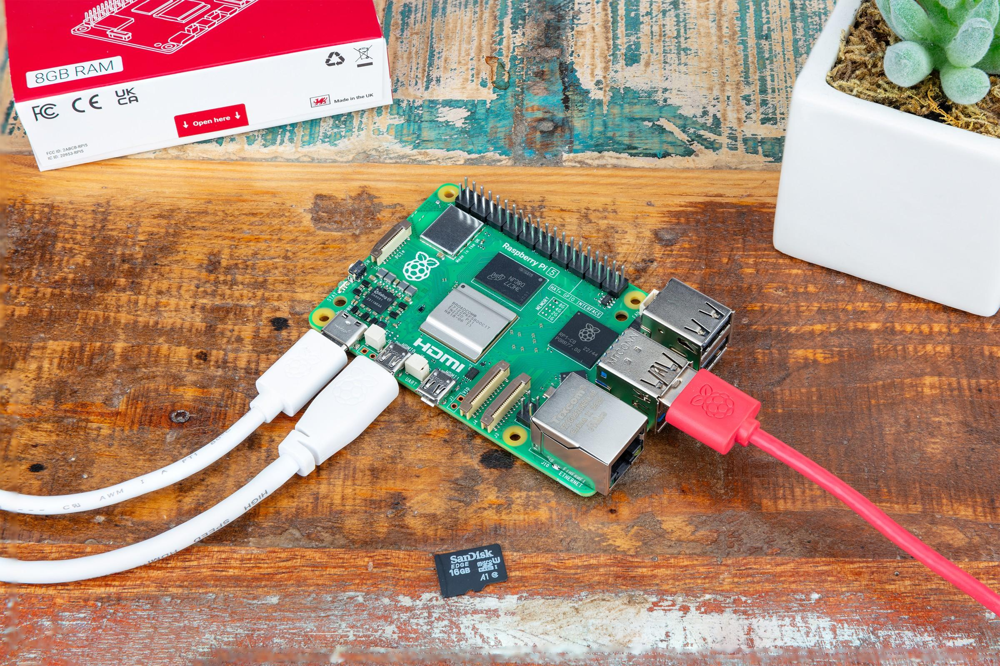
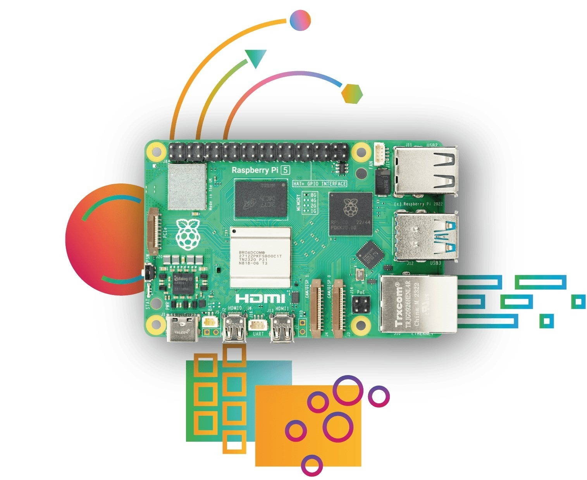

# Hardware e cablaggio

## Cosa ti serve

- Un Raspberry Pi 5 (qualsiasi taglio di memoria) con un dissipatore.
- Una scheda microSD (16 GB o più) e il [Raspberry Pi Imager](https://www.raspberrypi.com/software/).
- L'alimentatore USB-C ufficiale da 27 W (5 V / 5 A).
- Un cavo Ethernet sulla stessa rete del PC.
- Per l'HMI: un monitor HDMI (cavo micro-HDMI) o un display DSI; con un monitor touch, anche il suo USB.
- Un PC con l'[editor ctrl32](https://ctrl32.com/download/) (Windows).
- Opzionale, per l'esempio all-in-one: un adattatore USB-RS485 con un modulo I/O Modbus RTU e un sensore di temperatura; un HAT CAN (MCP2515 o MCP251xFD).

## Alimentazione

| Sorgente | Dove | Nota |
|---|---|---|
| USB-C | il connettore di alimentazione | 5 V / 5 A - l'alimentatore ufficiale da 27 W |
| PoE+ | tramite un HAT PoE+ | opzionale |

!!! warning "Sottotensione"
    Con un alimentatore più debole il Pi rallenta e limita la corrente USB
    - un adattatore USB-RS485 o un monitor touch possono allora
    disconnettersi. Usa l'alimentatore da 27 W.

## Mappa dei pin

| GPIO | Funzione in ctrl32 | Nota |
|---|---|---|
| 2 | I2C1 SDA - chip I2C, RTC |  |
| 3 | I2C1 SCL |  |
| 4 | libero - non usato da ctrl32 | ⚠  |
| 8 | SPI0 CE0 - HAT CAN |  |
| 9 | SPI0 MISO - HAT CAN |  |
| 10 | SPI0 MOSI - HAT CAN |  |
| 11 | SPI0 SCLK - HAT CAN |  |
| 14 | UART TX - HAT RS-485 |  |
| 15 | UART RX - HAT RS-485 |  |
| 17 | libero - non usato da ctrl32 | ⚠  |
| 22 | libero - non usato da ctrl32 | ⚠  |
| 25 | Interrupt dell'HAT CAN (MCP2515) |  |
| 27 | libero - non usato da ctrl32 | ⚠  |

Su una scheda Linux i bus sono **nomi di dispositivo**, non pin: il
runtime apre ciò che indicano le impostazioni del dispositivo - `can0` per
un HAT CAN o un adattatore USB, `/dev/ttyUSB0` per un adattatore USB-RS485
(oppure la UART propria del Pi con un HAT RS-485). **Prepare a Linux
device** li configura (passo 3 dell'installazione). La seconda porta
Ethernet per EtherCAT è un adattatore Ethernet USB.

## Sicurezza

- La scheda non è destinata a funzioni di sicurezza. Un arresto di
  emergenza, un interruttore della porta o una barriera fotoelettrica si
  cablano in hardware, mai tramite un programma.
- Spegni il Pi prima di togliere l'alimentazione, quando puoi - il runtime
  tiene al sicuro i valori ritentivi, il sistema operativo preferisce un
  arresto pulito.

## Foto

---

[← Panoramica](README.it.md) | [Panoramica](README.it.md) | [Installare il runtime →](install.it.md)
