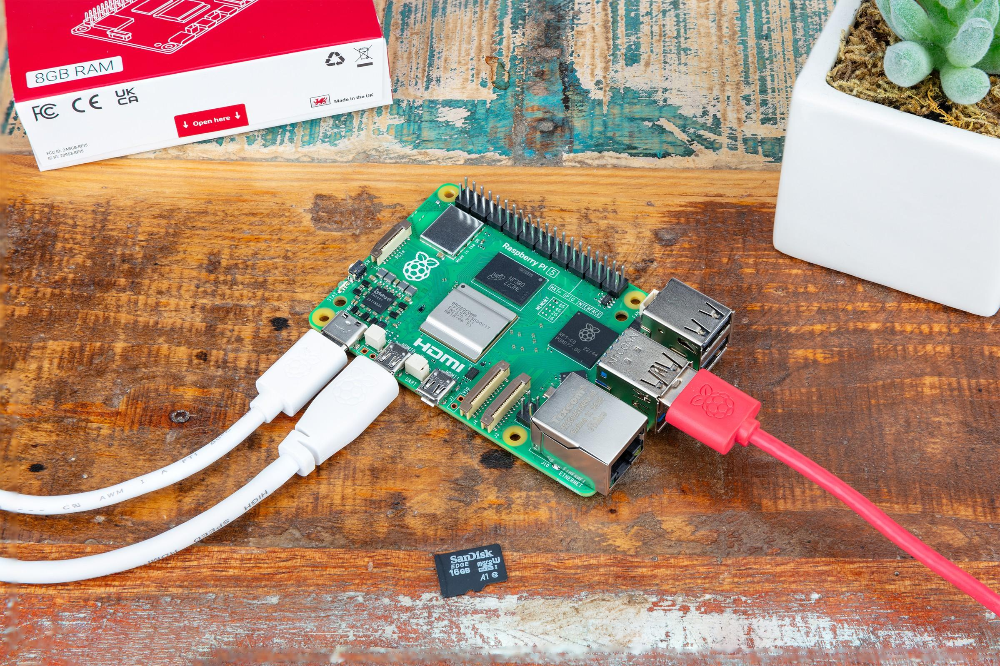
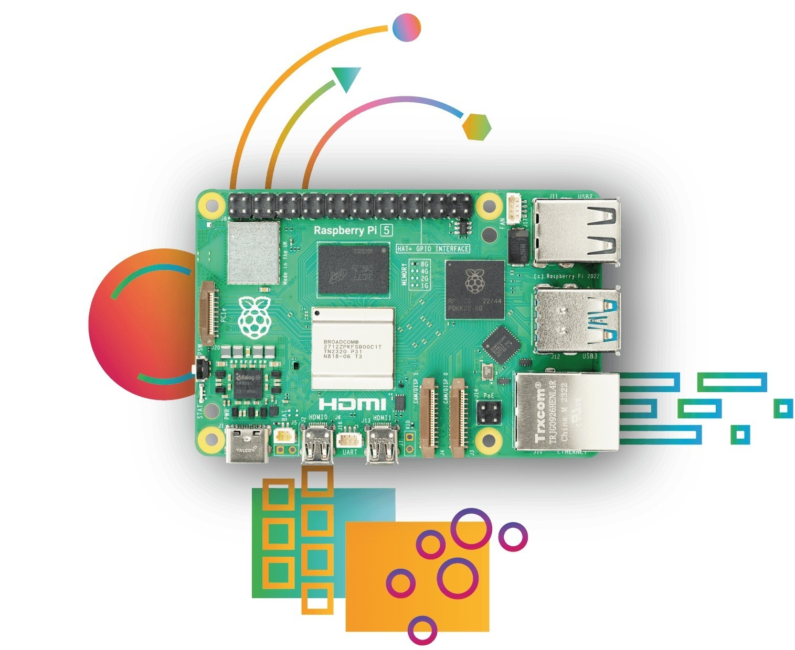

# Hardware and wiring

## What you need

- A Raspberry Pi 5 (any memory size) with a cooler.
- A microSD card (16 GB or more) and the [Raspberry Pi Imager](https://www.raspberrypi.com/software/).
- The official 27 W USB-C power supply (5 V / 5 A).
- An Ethernet cable on the same network as the PC.
- For the HMI: an HDMI monitor (micro-HDMI cable) or a DSI display; with a touch monitor, its USB.
- A PC with the [ctrl32 editor](https://ctrl32.com/download/) (Windows).
- Optional, for the all-in-one example: a USB-RS485 adapter with a Modbus RTU I/O module and a temperature sensor; a CAN HAT (MCP2515 or MCP251xFD).

## Power

| Source | Where | Note |
|---|---|---|
| USB-C | the power connector | 5 V / 5 A - the official 27 W supply |
| PoE+ | through a PoE+ HAT | optional |

!!! warning "Undervoltage"
    A weaker supply makes the Pi throttle and limit the USB current - a
    USB-RS485 adapter or a touch monitor may then drop out. Use the 27 W
    supply.

## Pin map

| GPIO | Function in ctrl32 | Note |
|---|---|---|
| 2 | I2C1 SDA - I2C chips, RTC |  |
| 3 | I2C1 SCL |  |
| 4 | free - not used by ctrl32 | ⚠  |
| 8 | SPI0 CE0 - CAN HAT |  |
| 9 | SPI0 MISO - CAN HAT |  |
| 10 | SPI0 MOSI - CAN HAT |  |
| 11 | SPI0 SCLK - CAN HAT |  |
| 14 | UART TX - RS-485 HAT |  |
| 15 | UART RX - RS-485 HAT |  |
| 17 | free - not used by ctrl32 | ⚠  |
| 22 | free - not used by ctrl32 | ⚠  |
| 25 | CAN HAT interrupt (MCP2515) |  |
| 27 | free - not used by ctrl32 | ⚠  |

On a Linux board the buses are **device names**, not pins: the runtime
opens what the device's settings name - `can0` for a CAN HAT or a USB
adapter, `/dev/ttyUSB0` for a USB-RS485 adapter (or the Pi's own UART with
an RS-485 HAT). **Prepare a Linux device** sets them up (step 3 of the
installation). The second Ethernet port for EtherCAT is a USB Ethernet
adapter.

## Safety

- The board is not intended for safety functions. An emergency stop, a
  door switch or a light curtain is wired in hardware, never through a
  program.
- Shut the Pi down before removing its power where you can - the runtime
  keeps the retained values safe, the operating system prefers a clean
  stop.

## Photos

---

[← Overview](README.md) | [Overview](README.md) | [Install the runtime →](install.md)
