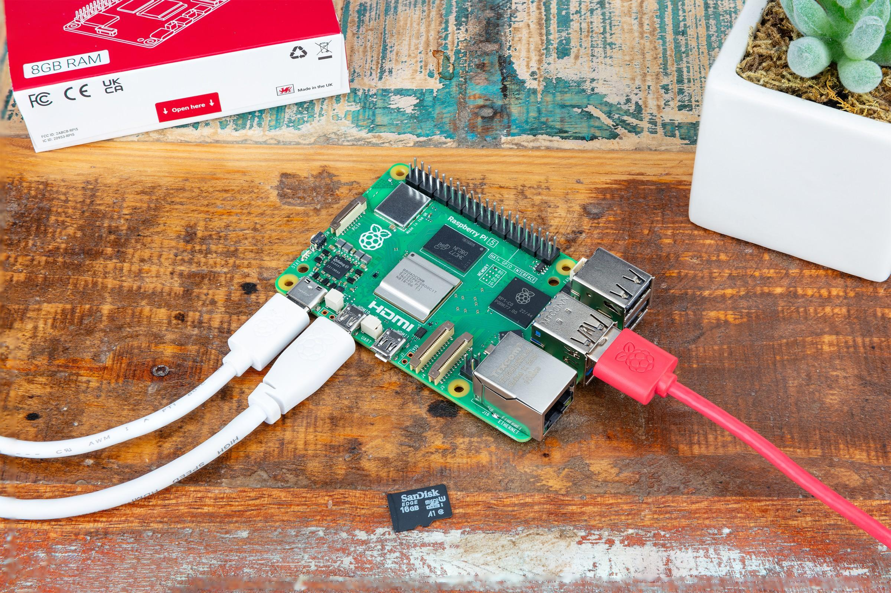
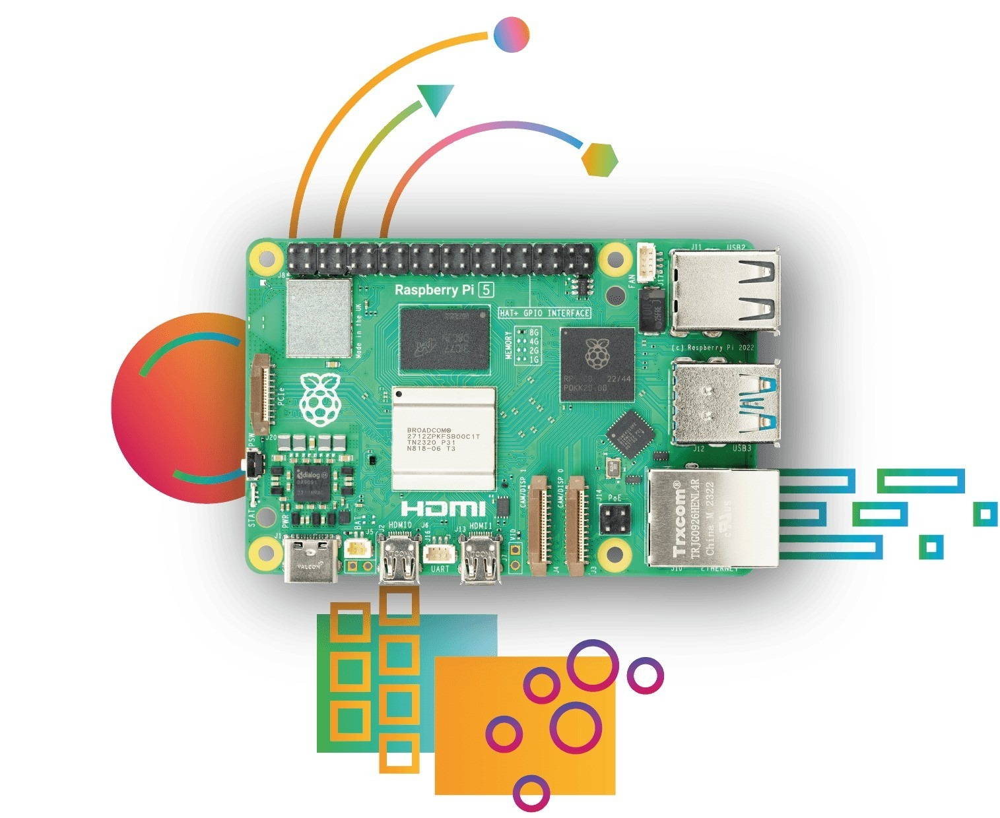

# Sprzęt i okablowanie

## Czego potrzebujesz

- Raspberry Pi 5 (dowolny rozmiar pamięci) z chłodzeniem.
- Karta microSD (16 GB lub więcej) i [Raspberry Pi Imager](https://www.raspberrypi.com/software/).
- Oficjalny zasilacz USB-C 27 W (5 V / 5 A).
- Kabel Ethernet w tej samej sieci co PC.
- Dla HMI: monitor HDMI (kabel micro-HDMI) lub wyświetlacz DSI; przy monitorze dotykowym także jego USB.
- PC z [edytorem ctrl32](https://ctrl32.com/download/) (Windows).
- Opcjonalnie, dla przykładu all-in-one: adapter USB-RS485 z modułem I/O Modbus RTU i czujnikiem temperatury; nakładka CAN HAT (MCP2515 lub MCP251xFD).

## Zasilanie

| Źródło | Gdzie | Uwaga |
|---|---|---|
| USB-C | złącze zasilania | 5 V / 5 A - oficjalny zasilacz 27 W |
| PoE+ | przez nakładkę PoE+ HAT | opcjonalnie |

!!! warning "Zbyt niskie napięcie"
    Przy słabszym zasilaczu Pi zwalnia i ogranicza prąd USB - adapter
    USB-RS485 lub monitor dotykowy może wtedy się odłączać. Używaj
    zasilacza 27 W.

## Mapa pinów

| GPIO | Funkcja w ctrl32 | Uwaga |
|---|---|---|
| 2 | I2C1 SDA - układy I2C, RTC |  |
| 3 | I2C1 SCL |  |
| 4 | wolny - nieużywany przez ctrl32 | ⚠  |
| 8 | SPI0 CE0 - nakładka CAN HAT |  |
| 9 | SPI0 MISO - nakładka CAN HAT |  |
| 10 | SPI0 MOSI - nakładka CAN HAT |  |
| 11 | SPI0 SCLK - nakładka CAN HAT |  |
| 14 | UART TX - nakładka RS-485 HAT |  |
| 15 | UART RX - nakładka RS-485 HAT |  |
| 17 | wolny - nieużywany przez ctrl32 | ⚠  |
| 22 | wolny - nieużywany przez ctrl32 | ⚠  |
| 25 | przerwanie nakładki CAN HAT (MCP2515) |  |
| 27 | wolny - nieużywany przez ctrl32 | ⚠  |

Na płytce z Linuksem magistrale to **nazwy urządzeń**, a nie piny:
runtime otwiera to, co wskazują ustawienia urządzenia - `can0` dla
nakładki CAN HAT lub adaptera USB, `/dev/ttyUSB0` dla adaptera USB-RS485
(albo własny UART Pi z nakładką RS-485 HAT). **Prepare a Linux device**
je konfiguruje (krok 3 instalacji). Drugi port Ethernet dla EtherCAT to
adapter USB Ethernet.

## Bezpieczeństwo

- Płytka nie jest przeznaczona do funkcji bezpieczeństwa. Wyłącznik
  awaryjny, wyłącznik drzwi lub kurtyna świetlna są podłączone sprzętowo,
  nigdy przez program.
- Tam, gdzie to możliwe, wyłącz Pi przed odłączeniem zasilania - runtime
  chroni wartości retencyjne, a system operacyjny woli czyste
  zamknięcie.

## Zdjęcia

---

[← Przegląd](README.pl.md) | [Przegląd](README.pl.md) | [Instalacja runtime →](install.pl.md)
