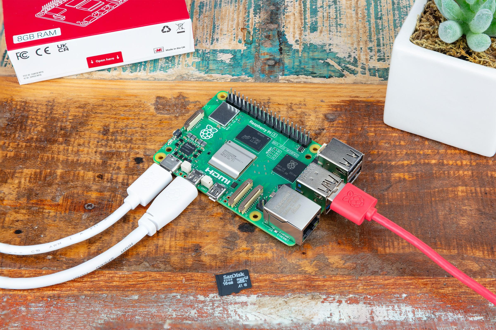
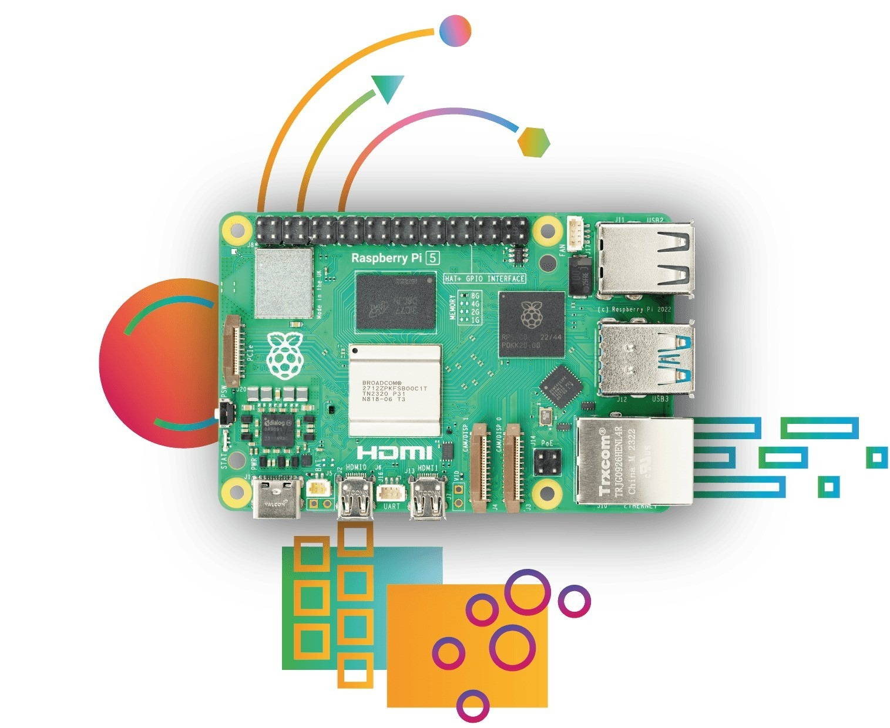

# Hardware și cablare

## De ce ai nevoie

- Un Raspberry Pi 5 (orice dimensiune de memorie) cu un răcitor.
- Un card microSD (16 GB sau mai mult) și [Raspberry Pi Imager](https://www.raspberrypi.com/software/).
- Sursa de alimentare USB-C oficială de 27 W (5 V / 5 A).
- Un cablu Ethernet în aceeași rețea cu PC-ul.
- Pentru HMI: un monitor HDMI (cablu micro-HDMI) sau un display DSI; la un monitor tactil, și USB-ul lui.
- Un PC cu [editorul ctrl32](https://ctrl32.com/download/) (Windows).
- Opțional, pentru exemplul all-in-one: un adaptor USB-RS485 cu un modul I/O Modbus RTU și un senzor de temperatură; un HAT CAN (MCP2515 sau MCP251xFD).

## Alimentare

| Sursă | Unde | Notă |
|---|---|---|
| USB-C | conectorul de alimentare | 5 V / 5 A - sursa oficială de 27 W |
| PoE+ | printr-un HAT PoE+ | opțional |

!!! warning "Subtensiune"
    O sursă mai slabă face ca Pi-ul să-și reducă frecvența și să limiteze
    curentul USB - un adaptor USB-RS485 sau un monitor tactil poate atunci
    să cadă. Folosește sursa de 27 W.

## Harta pinilor

| GPIO | Funcție în ctrl32 | Notă |
|---|---|---|
| 2 | I2C1 SDA - cipuri I2C, RTC |  |
| 3 | I2C1 SCL |  |
| 4 | liber - nefolosit de ctrl32 | ⚠  |
| 8 | SPI0 CE0 - HAT CAN |  |
| 9 | SPI0 MISO - HAT CAN |  |
| 10 | SPI0 MOSI - HAT CAN |  |
| 11 | SPI0 SCLK - HAT CAN |  |
| 14 | UART TX - HAT RS-485 |  |
| 15 | UART RX - HAT RS-485 |  |
| 17 | liber - nefolosit de ctrl32 | ⚠  |
| 22 | liber - nefolosit de ctrl32 | ⚠  |
| 25 | Întreruperea HAT-ului CAN (MCP2515) |  |
| 27 | liber - nefolosit de ctrl32 | ⚠  |

Pe o placă Linux magistralele sunt **nume de dispozitiv**, nu pini:
runtime-ul deschide ce numesc setările dispozitivului - `can0` pentru un
HAT CAN sau un adaptor USB, `/dev/ttyUSB0` pentru un adaptor USB-RS485
(sau UART-ul propriu al Pi-ului cu un HAT RS-485). **Prepare a Linux
device** le configurează (pasul 3 al instalării). Al doilea port Ethernet
pentru EtherCAT este un adaptor Ethernet USB.

## Siguranță

- Placa nu este destinată funcțiilor de siguranță. O oprire de urgență,
  un contact de ușă sau o barieră optică se cablează în hardware,
  niciodată printr-un program.
- Oprește Pi-ul înainte de a-i lua alimentarea, acolo unde poți -
  runtime-ul păstrează în siguranță valorile remanente, sistemul de
  operare preferă o oprire curată.

## Fotografii

---

[← Prezentare](README.ro.md) | [Prezentare](README.ro.md) | [Instalarea runtime-ului →](install.ro.md)
