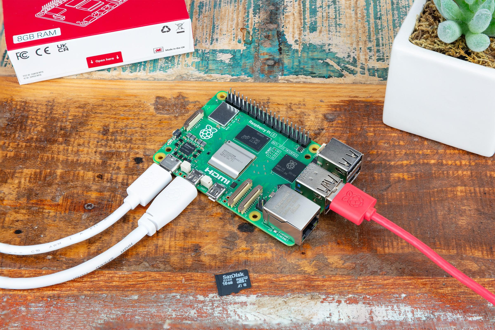
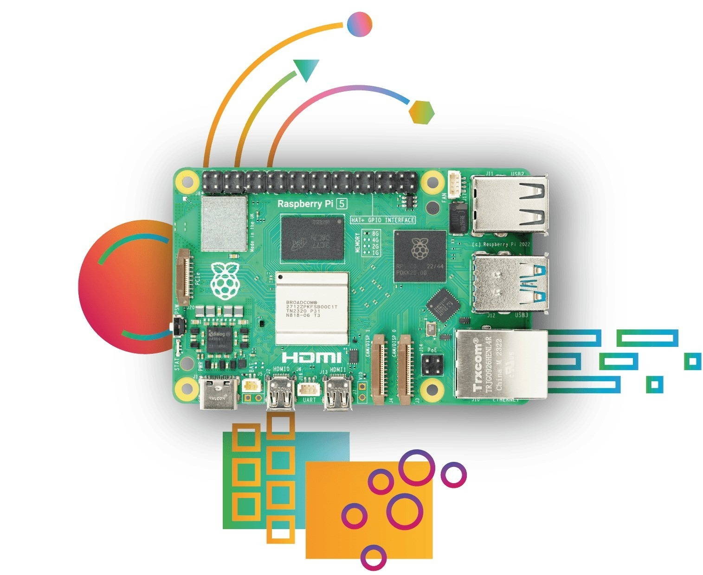

# Hardvér a zapojenie

## Čo treba

- Raspberry Pi 5 (akákoľvek veľkosť pamäte) s chladičom.
- Karta microSD (16 GB a viac) a [Raspberry Pi Imager](https://www.raspberrypi.com/software/).
- Oficiálny zdroj USB-C 27 W (5 V / 5 A).
- Sieťový kábel v tej istej sieti ako PC.
- Pre HMI: monitor HDMI (kábel micro-HDMI) alebo displej DSI; pri dotykovom monitore aj jeho USB.
- PC s [editorom ctrl32](https://ctrl32.com/download/) (Windows).
- Voliteľne pre príklad all-in-one: adaptér USB-RS485 s I/O modulom Modbus RTU a senzorom teploty; CAN HAT (MCP2515 alebo MCP251xFD).

## Napájanie

| Zdroj | Kde | Poznámka |
|---|---|---|
| USB-C | napájací konektor | 5 V / 5 A - oficiálny zdroj 27 W |
| PoE+ | cez PoE+ HAT | voliteľné |

!!! warning "Podpätie"
    Pri slabšom zdroji Pi spomalí a obmedzí prúd do USB - adaptér
    USB-RS485 alebo dotykový monitor potom môže vypadnúť. Použi zdroj
    27 W.

## Mapa pinov

| GPIO | Funkcia v ctrl32 | Poznámka |
|---|---|---|
| 2 | I2C1 SDA - čipy I2C, RTC |  |
| 3 | I2C1 SCL |  |
| 4 | voľný - ctrl32 ho nepoužíva | ⚠  |
| 8 | SPI0 CE0 - CAN HAT |  |
| 9 | SPI0 MISO - CAN HAT |  |
| 10 | SPI0 MOSI - CAN HAT |  |
| 11 | SPI0 SCLK - CAN HAT |  |
| 14 | UART TX - RS-485 HAT |  |
| 15 | UART RX - RS-485 HAT |  |
| 17 | voľný - ctrl32 ho nepoužíva | ⚠  |
| 22 | voľný - ctrl32 ho nepoužíva | ⚠  |
| 25 | prerušenie CAN HAT (MCP2515) |  |
| 27 | voľný - ctrl32 ho nepoužíva | ⚠  |

Na doske s Linuxom sú zbernice **mená zariadení**, nie piny: runtime
otvorí to, čo pomenujú nastavenia zariadenia - `can0` pre CAN HAT alebo
USB adaptér, `/dev/ttyUSB0` pre adaptér USB-RS485 (alebo vlastný UART Pi
s RS-485 HAT). **Prepare a Linux device** ich nastaví (krok 3
inštalácie). Druhý port Ethernet pre EtherCAT je USB adaptér Ethernet.

## Bezpečnosť

- Doska nie je určená na bezpečnostné funkcie. Núdzové zastavenie, dverový
  spínač či svetelná závora sa zapájajú v hardvéri, nikdy cez program.
- Kde sa dá, vypni Pi pred odpojením napájania - runtime zachovávané
  hodnoty ochráni, operačný systém má radšej čisté zastavenie.

## Fotky

---

[← Prehľad](README.sk.md) | [Prehľad](README.sk.md) | [Nahratie runtime →](install.sk.md)
