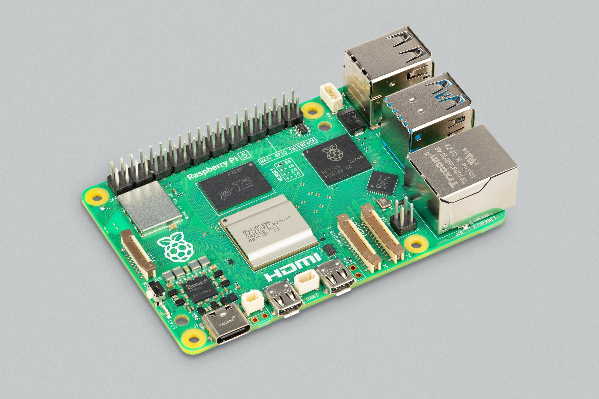
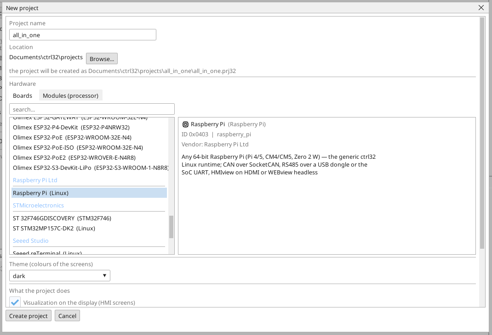
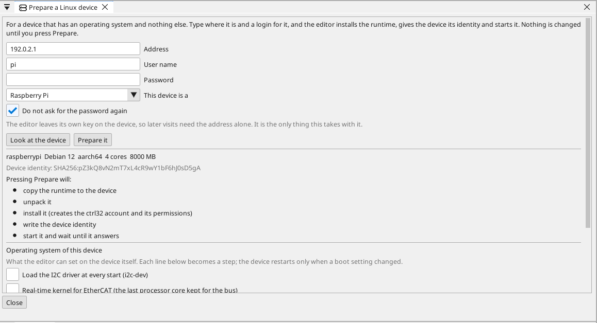
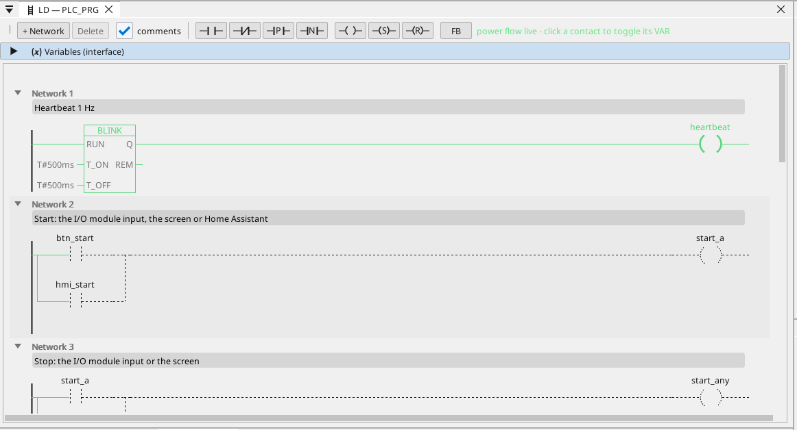

# Nahrání runtime ctrl32

Linux runtime ctrl32 je program v desce, který vykonává tvůj projekt - cyklus PLC, obrazovku na monitoru, WEBview, OPC UA a sběrnice. Editor ho nainstaluje přes síť; nepíše se žádný linuxový příkaz.

## 1. Zapiš kartu

Nahraj na kartu **Raspberry Pi OS Lite (64-bit)** pomocí Raspberry Pi
Imageru. *Lite* je záměr: runtime kreslí obrazovku sám a desktop
nepotřebuje. V nastavení Imageru před zápisem nastav:

- **hostname**, podle kterého Pi v síti poznáš,
- **uživatele** a jeho **heslo**,
- **zapnuté SSH**,
- Wi-Fi jen tehdy, když Pi nebude na kabelu.

Vlož kartu do Pi, připoj Ethernet a monitor a zapni ho.

## 2. Vytvoř projekt

Spusť editor ctrl32 a zvol **New project** (Ctrl+N). Zadej **název** projektu, pod **Linux** vyber **Raspberry Pi** a stiskni **Create project**.

Chceš-li začít hotovým příkladem, otevři [projekt all-in-one](examples/all-in-one/README.cs.md) (**File → Open**).

## 3. Připrav desku

Zvol **Online → Prepare a Linux device**. Zadej **adresu** desky, **uživatele** a **heslo** z kroku 1 a stiskni **Look at the device**: editor se přihlásí, zjistí, co je deska zač, a vypíše, co udělá - podívání nic nemění. Pak stiskni **Prepare it**: editor zkopíruje runtime, nainstaluje ho jako službu, spustí ho a počká, až odpoví. Od té chvíle deska spouští runtime při každém startu.

Nech zaškrtnuté **Do not ask for the password again**: editor uloží do desky vlastní klíč a při dalších návštěvách stačí adresa. Heslo se použije jednou a nikde se neukládá.

Pod plánem je **Operating system of this device** - to, co patří k Pi,
a ne k projektu: CAN HAT (jeden řádek na každý čip CAN na SPI), uvolnění
sériového portu pro RS-485 HAT, I2C, pevná adresa a real-time jádro pro
EtherCAT. Zaškrtni, co tvoje Pi nese; každý zaškrtnutý řádek je jeden
krok a Pi se restartuje, jen když se změnilo nastavení startu.

## 4. Nahraj projekt

Zadej adresu desky do výběru portu na panelu nástrojů a stiskni tlačítko nahrání (F5). Runtime projekt načte a na monitoru se objeví obrazovka.

## 5. Ověř, že běží

- **ONLINE** (ikona zástrčky) ukáže živé hodnoty v příčkách, proměnných i na obrazovce.
- **WEBview**: `http://<adresa>:8080` v prohlížeči ve stejné síti.
- **OPC UA**: `opc.tcp://<adresa>:4840` - každá proměnná je uzel, `ns=1;s=<jméno>`.

| Port | Co tam běží |
|---|---|
| 8080 | WEBview, nahrání programu, hledání zařízení |
| 4840 | server OPC UA |
| 3232 | online spojení editoru |

Něco nejde? Viz [Řešení problémů](troubleshooting.cs.md).

*Snímky obrazovky: editor ctrl32 1.07.*

---

[← Hardware a zapojení](hardware.cs.md) | [Přehled](README.cs.md) | [Nastavení →](configure.cs.md)
