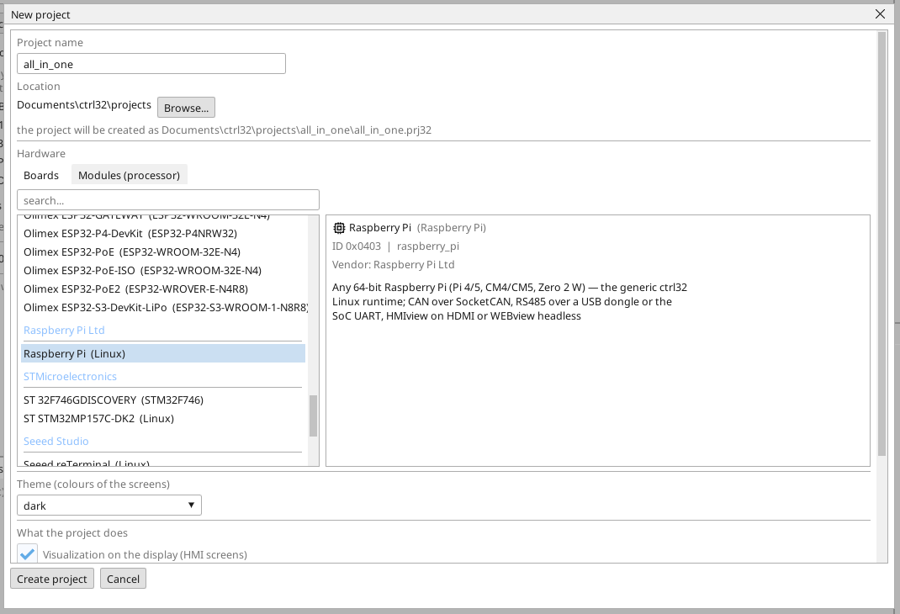

# Die ctrl32-Runtime installieren

Die ctrl32-Linux-Runtime ist das Programm auf dem Board, das Ihr Projekt ausführt - den SPS-Zyklus, den Bildschirm am Monitor, WEBview, OPC UA und die Busse. Der Editor installiert sie über das Netzwerk; kein Linux-Befehl wird getippt.

## 1. Die Karte beschreiben

Schreiben Sie **Raspberry Pi OS Lite (64-bit)** mit dem Raspberry Pi Imager
auf die Karte. *Lite* ist Absicht: die Runtime zeichnet den Bildschirm
selbst und braucht keinen Desktop. Stellen Sie in den Einstellungen des
Imagers vor dem Schreiben ein:

- einen **Hostnamen**, den Sie im Netzwerk wiedererkennen,
- einen **Benutzer** und sein **Passwort**,
- **SSH aktiviert**,
- das WLAN nur dann, wenn der Pi nicht am Kabel hängen wird.

Stecken Sie die Karte in den Pi, schließen Sie Ethernet und den Monitor an
und schalten Sie ihn ein.

## 2. Das Projekt anlegen

Starten Sie den ctrl32-Editor und wählen Sie **New project** (Strg+N). Geben Sie den **Namen** des Projekts ein, wählen Sie **Raspberry Pi** unter **Linux** und drücken Sie **Create project**.

Um stattdessen mit dem fertigen Beispiel zu beginnen, öffnen Sie das [All-in-one-Projekt](examples/all-in-one/README.de.md) (**File → Open**).

## 3. Das Board vorbereiten

Wählen Sie **Online → Prepare a Linux device**. Geben Sie die **Adresse** des Boards, den **Benutzer** und das **Passwort** aus Schritt 1 ein und drücken Sie **Look at the device**: der Editor meldet sich an, liest, was das Board ist, und listet auf, was er tun wird - das Nachsehen ändert nichts. Drücken Sie dann **Prepare it**: der Editor kopiert die Runtime, installiert sie als Dienst, startet sie und wartet, bis sie antwortet. Von da an startet das Board die Runtime bei jedem Booten.

Lassen Sie **Do not ask for the password again** angehakt: der Editor hinterlegt seinen eigenen Schlüssel auf dem Board, und spätere Besuche brauchen nur noch die Adresse. Das Passwort wird einmal benutzt und nie gespeichert.

Unter dem Plan steht **Operating system of this device** - das, was zum Pi
und nicht zum Projekt gehört: der CAN-HAT (eine Zeile je CAN-Chip an SPI),
das Freigeben der seriellen Schnittstelle für einen RS-485-HAT, I2C, eine
feste Adresse und der Echtzeit-Kernel für EtherCAT. Haken Sie an, was Ihr
Pi trägt; jede angehakte Zeile ist ein Schritt, und der Pi startet nur
dann neu, wenn sich eine Boot-Einstellung geändert hat.

## 4. Das Projekt laden

Geben Sie die Adresse des Boards in die Portauswahl der Symbolleiste ein und drücken Sie die Download-Schaltfläche (F5). Die Runtime lädt das Projekt, und der Bildschirm erscheint am Monitor.

## 5. Prüfen, dass es läuft

- **ONLINE** (das Steckersymbol) zeigt die Live-Werte in den Strompfaden, den Variablen und auf dem Bildschirm.
- **WEBview**: `http://<Adresse>:8080` in einem Browser im selben Netzwerk.
- **OPC UA**: `opc.tcp://<Adresse>:4840` - jede Variable ist ein Knoten, `ns=1;s=<Name>`.

| Port | Was dort läuft |
|---|---|
| 8080 | WEBview, der Programm-Upload, das Finden des Geräts |
| 4840 | der OPC-UA-Server |
| 3232 | die Online-Verbindung des Editors |

Etwas geht nicht? Siehe [Fehlersuche](troubleshooting.de.md).

*Bildschirmfotos: ctrl32-Editor 1.07.*

---

[← Hardware und Verdrahtung](hardware.de.md) | [Übersicht](README.de.md) | [Einrichten →](configure.de.md)
