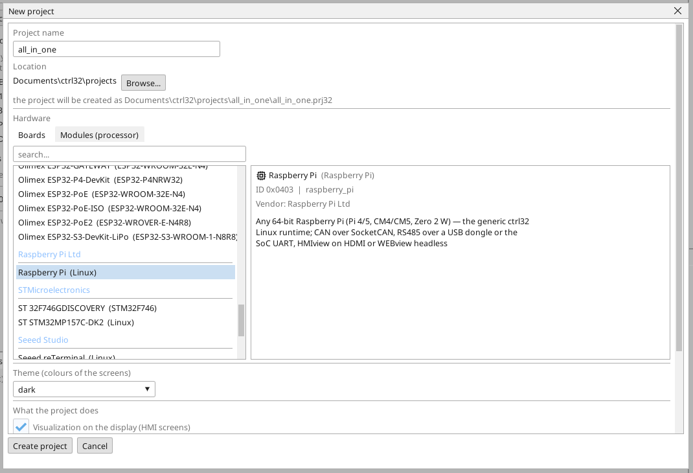

# Instalar el runtime de ctrl32

El runtime Linux de ctrl32 es el programa de la placa que ejecuta tu proyecto - el ciclo del PLC, la pantalla en el monitor, WEBview, OPC UA y los buses. El editor lo instala por la red; no se escribe ningún comando de Linux.

## 1. Grabar la tarjeta

Graba **Raspberry Pi OS Lite (64-bit)** en la tarjeta con el Raspberry Pi
Imager. *Lite* es a propósito: el runtime dibuja la pantalla por sí mismo
y no necesita escritorio. En los ajustes del Imager, antes de grabar,
configura:

- un **nombre de host** que reconozcas en la red,
- un **usuario** y su **contraseña**,
- **SSH activado**,
- la Wi-Fi solo si la Pi no va a estar en un cable.

Pon la tarjeta en la Pi, conecta Ethernet y el monitor, y enciéndela.

## 2. Crear el proyecto

Inicia el editor ctrl32 y elige **New project** (Ctrl+N). Escribe el **nombre** del proyecto, elige **Raspberry Pi** en **Linux** y pulsa **Create project**.

Para empezar en cambio desde el ejemplo listo, abre el [proyecto all-in-one](examples/all-in-one/README.es.md) (**File → Open**).

## 3. Preparar la placa

Elige **Online → Prepare a Linux device**. Escribe la **dirección** de la placa, el **usuario** y la **contraseña** del paso 1 y pulsa **Look at the device**: el editor inicia sesión, lee qué placa es y enumera lo que va a hacer - mirar no cambia nada. Después pulsa **Prepare it**: el editor copia el runtime, lo instala como servicio, lo arranca y espera hasta que responde. A partir de entonces la placa arranca el runtime en cada inicio.

Deja marcado **Do not ask for the password again**: el editor pone su propia clave en la placa y las visitas posteriores solo necesitan la dirección. La contraseña se usa una vez y nunca se guarda.

Debajo del plan, **Operating system of this device** reúne lo que
pertenece a la Pi y no al proyecto: el HAT CAN (una fila por chip CAN en
SPI), liberar el puerto serie para un HAT RS-485, I2C, una dirección fija
y el kernel de tiempo real para EtherCAT. Marca lo que lleva tu Pi; cada
línea marcada es un paso, y la Pi solo se reinicia cuando ha cambiado un
ajuste de arranque.

## 4. Descargar el proyecto

Escribe la dirección de la placa en el selector de puertos de la barra de herramientas y pulsa el botón de descarga (F5). El runtime carga el proyecto y la pantalla aparece en el monitor.

## 5. Comprobar que funciona

- **ONLINE** (el icono del enchufe) muestra los valores en vivo en los escalones, las variables y la pantalla.
- **WEBview**: `http://<dirección>:8080` en un navegador de la misma red.
- **OPC UA**: `opc.tcp://<dirección>:4840` - cada variable es un nodo, `ns=1;s=<nombre>`.

| Puerto | Qué hay ahí |
|---|---|
| 8080 | WEBview, la carga del programa, la búsqueda del dispositivo |
| 4840 | el servidor OPC UA |
| 3232 | la conexión online del editor |

¿Algo no funciona? Consulta [Solución de problemas](troubleshooting.es.md).

*Capturas de pantalla: editor ctrl32 1.07.*

---

[← Hardware y cableado](hardware.es.md) | [Resumen](README.es.md) | [Configurar →](configure.es.md)
