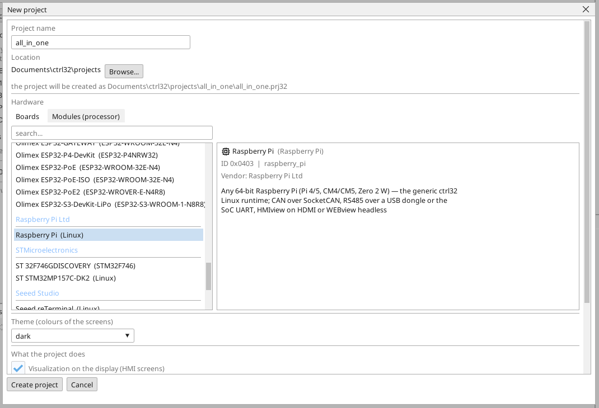

# A ctrl32 runtime telepítése

A ctrl32 Linux runtime az a program a panelen, amely a projektedet futtatja - a PLC ciklust, a képernyőt a monitoron, a WEBview-t, az OPC UA-t és a buszokat. A szerkesztő hálózaton telepíti; egyetlen Linux parancsot sem kell begépelni.

## 1. A kártya megírása

Írd fel a **Raspberry Pi OS Lite (64-bit)** rendszert a kártyára a
Raspberry Pi Imagerrel. A *Lite* szándékos: a runtime maga rajzolja a
képernyőt, és nincs szüksége asztali környezetre. Az Imager beállításaiban
írás előtt add meg:

- egy **hosztnevet**, amelyet felismersz a hálózaton,
- egy **felhasználót** és a **jelszavát**,
- **SSH bekapcsolva**,
- a Wi-Fi-t csak akkor, ha a Pi nem lesz kábelen.

Tedd a kártyát a Pi-be, csatlakoztasd az Ethernetet és a monitort, és
kapcsold be.

## 2. A projekt létrehozása

Indítsd el a ctrl32 szerkesztőt, és válaszd a **New project** pontot (Ctrl+N). Írd be a projekt **nevét**, válaszd ki a(z) **Raspberry Pi** panelt a **Linux** alatt, és nyomd meg a **Create project** gombot.

Ha inkább a kész példából indulnál, nyisd meg az [all-in-one projektet](examples/all-in-one/README.hu.md) (**File → Open**).

## 3. A panel előkészítése

Válaszd az **Online → Prepare a Linux device** menüpontot. Írd be a panel **címét**, valamint az 1. lépés **felhasználóját** és **jelszavát**, és nyomd meg a **Look at the device** gombot: a szerkesztő bejelentkezik, kiolvassa, milyen panel ez, és felsorolja, mit fog tenni - a megtekintés semmit sem változtat. Ezután nyomd meg a **Prepare it** gombot: a szerkesztő átmásolja a runtime-ot, szolgáltatásként telepíti, elindítja, és megvárja, amíg válaszol. Ettől kezdve a panel minden indításkor elindítja a runtime-ot.

Hagyd bejelölve a **Do not ask for the password again** négyzetet: a szerkesztő a saját kulcsát teszi a panelre, és a későbbi látogatásokhoz már csak a cím kell. A jelszót egyszer használja, és soha nem tárolja.

A terv alatt az **Operating system of this device** azt tartalmazza, ami a
Pi-hez tartozik és nem a projekthez: a CAN HAT (CAN chipenként egy sor az
SPI-n), a soros port felszabadítása egy RS-485 HAT számára, az I2C, egy
fix cím és a valós idejű kernel az EtherCAT-hez. Jelöld be, ami a Pi-den
van; minden bejelölt sor egy lépés, és a Pi csak akkor indul újra, ha egy
rendszerindítási beállítás megváltozott.

## 4. A projekt letöltése

Írd be a panel címét az eszköztár portválasztójába, és nyomd meg a letöltés gombot (F5). A runtime betölti a projektet, és a képernyő megjelenik a monitoron.

## 5. Ellenőrizd, hogy fut

- **ONLINE** (a dugó ikon) megmutatja az élő értékeket a létrafokokban, a változókban és a képernyőn.
- **WEBview**: `http://<cím>:8080` egy böngészőben ugyanazon a hálózaton.
- **OPC UA**: `opc.tcp://<cím>:4840` - minden változó egy csomópont, `ns=1;s=<név>`.

| Port | Mi fut ott |
|---|---|
| 8080 | WEBview, a program feltöltése, az eszköz megtalálása |
| 4840 | az OPC UA szerver |
| 3232 | a szerkesztő online kapcsolata |

Valami nem működik? Lásd [Hibaelhárítás](troubleshooting.hu.md).

*Képernyőképek: ctrl32 szerkesztő 1.07.*

---

[← Hardver és bekötés](hardware.hu.md) | [Áttekintés](README.hu.md) | [Beállítás →](configure.hu.md)
