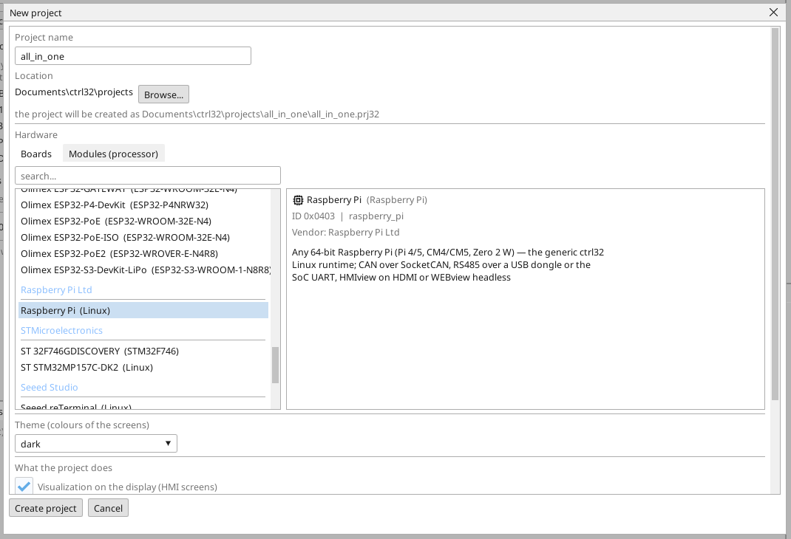

# Instalacja runtime ctrl32

Runtime ctrl32 dla Linuksa to program na płytce, który wykonuje twój projekt - cykl PLC, ekran na monitorze, WEBview, OPC UA i magistrale. Edytor instaluje go przez sieć; nie wpisuje się żadnego polecenia Linuksa.

## 1. Zapis karty

Zapisz **Raspberry Pi OS Lite (64-bit)** na karcie za pomocą Raspberry Pi
Imager. *Lite* jest celowe: runtime sam rysuje ekran i nie potrzebuje
pulpitu. W ustawieniach Imagera przed zapisem ustaw:

- **nazwę hosta**, którą rozpoznasz w sieci,
- **użytkownika** i jego **hasło**,
- **włączone SSH**,
- Wi-Fi tylko wtedy, gdy Pi nie będzie na kablu.

Włóż kartę do Pi, podłącz Ethernet i monitor, a potem włącz zasilanie.

## 2. Tworzenie projektu

Uruchom edytor ctrl32 i wybierz **New project** (Ctrl+N). Wpisz **nazwę** projektu, wybierz **Raspberry Pi** w **Linux** i naciśnij **Create project**.

Aby zamiast tego zacząć od gotowego przykładu, otwórz [projekt all-in-one](examples/all-in-one/README.pl.md) (**File → Open**).

## 3. Przygotowanie płytki

Wybierz **Online → Prepare a Linux device**. Wpisz **adres** płytki, **użytkownika** i **hasło** z kroku 1 i naciśnij **Look at the device**: edytor loguje się, odczytuje, czym jest płytka, i wypisuje, co zrobi - samo sprawdzenie niczego nie zmienia. Następnie naciśnij **Prepare it**: edytor kopiuje runtime, instaluje go jako usługę, uruchamia i czeka, aż odpowie. Od tej chwili płytka uruchamia runtime przy każdym starcie.

Zostaw zaznaczone **Do not ask for the password again**: edytor umieszcza na płytce własny klucz, a kolejne wizyty wymagają już tylko adresu. Hasło jest użyte raz i nigdy nie jest zapisywane.

Pod planem **Operating system of this device** zawiera to, co należy do
Pi, a nie do projektu: nakładkę CAN HAT (jeden wiersz na każdy układ CAN
na SPI), zwolnienie portu szeregowego dla nakładki RS-485 HAT, I2C, stały
adres i jądro czasu rzeczywistego dla EtherCAT. Zaznacz to, co ma twoje
Pi; każdy zaznaczony wiersz to jeden krok, a Pi uruchamia się ponownie
tylko wtedy, gdy zmieniło się ustawienie startowe.

## 4. Wgranie projektu

Wpisz adres płytki w selektorze portów na pasku narzędzi i naciśnij przycisk wgrywania (F5). Runtime ładuje projekt, a ekran pojawia się na monitorze.

## 5. Sprawdź, czy działa

- **ONLINE** (ikona wtyczki) pokazuje bieżące wartości w szczeblach, zmiennych i na ekranie.
- **WEBview**: `http://<adres>:8080` w przeglądarce w tej samej sieci.
- **OPC UA**: `opc.tcp://<adres>:4840` - każda zmienna jest węzłem, `ns=1;s=<nazwa>`.

| Port | Co tam działa |
|---|---|
| 8080 | WEBview, wgrywanie programu, wyszukiwanie urządzenia |
| 4840 | serwer OPC UA |
| 3232 | połączenie online edytora |

Coś nie działa? Zobacz [Rozwiązywanie problemów](troubleshooting.pl.md).

*Zrzuty ekranu: edytor ctrl32 1.07.*

---

[← Sprzęt i okablowanie](hardware.pl.md) | [Przegląd](README.pl.md) | [Konfiguracja →](configure.pl.md)
